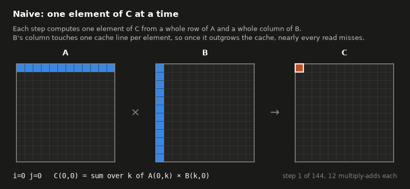
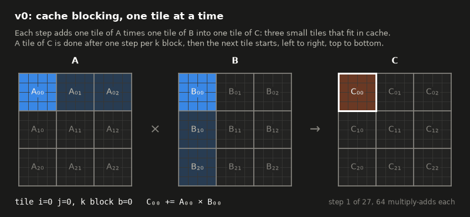
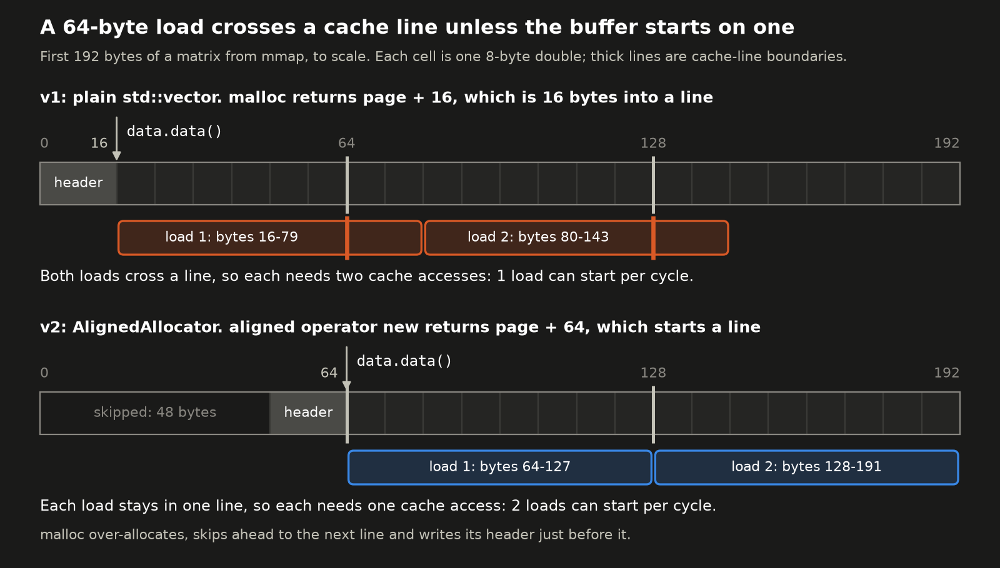
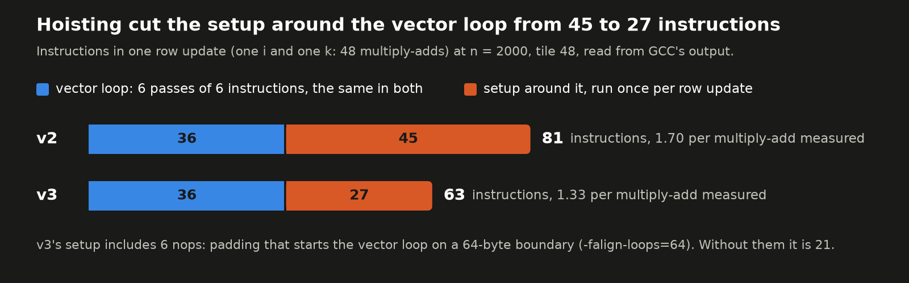
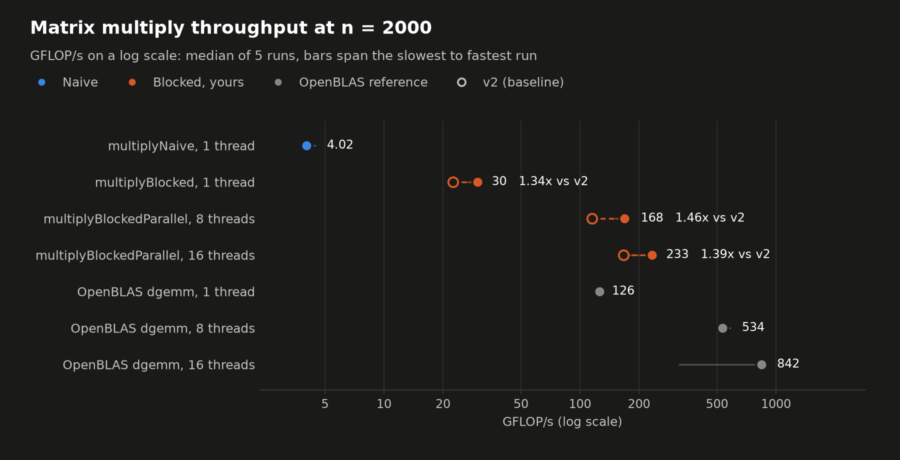
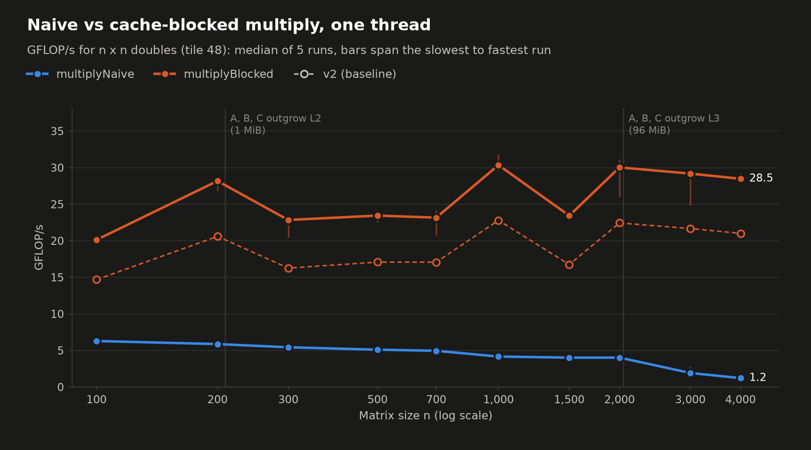
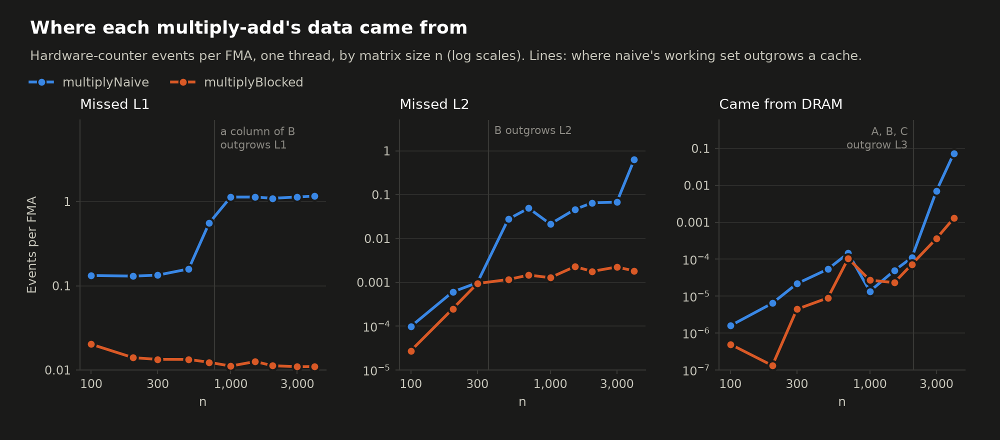
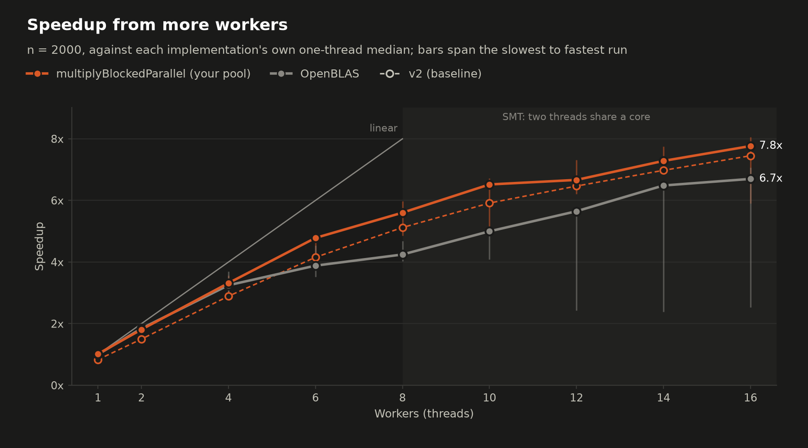
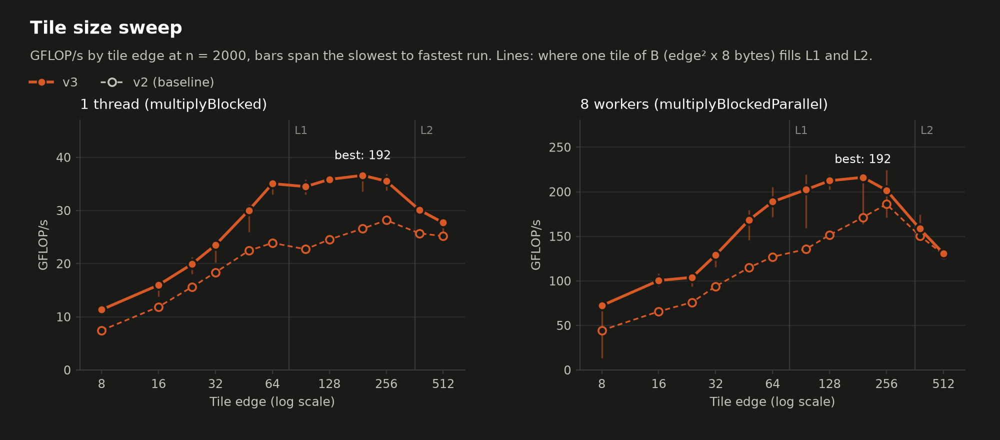

# My matmul optimization

A learning project that optimizes matrix multiplication step by step, with a hand-written thread
pool. The implementations are measured with
[Google Benchmark](https://github.com/google/benchmark), with hardware performance counters and
OpenBLAS as a reference.

| Question | Benchmarks | Chart |
|---|---|---|
| How much faster is cache blocking than the naive loop, and why? | `BM_Naive`, `BM_Blocked` over n = 100 to 4000 | `throughput_vs_size`, `cache_misses` |
| How well does the threadpool version scale? Do 16 workers help on 8 cores? | `BM_BlockedParallel`, 1 to 16 workers at n = 2000 | `thread_scaling` |
| Which tile size is best, and why? | `BM_Blocked` and `BM_BlockedParallel` (8 workers), tile edge 8 to 512 | `tile_sweep` |
| How far is this from a tuned library? | `BM_OpenBLAS`, same sizes and worker counts; `BM_AOCL` in its own suite (`build/bench_aocl`) | `headline` |

**Versions**

- [v0: cache blocking](#v0-cache-blocking)
- [v1: loop interchange for auto-vectorization](#v1-loop-interchange-i-k-j-for-auto-vectorization)
- [v2: cache-line-aligned storage](#v2-cache-line-aligned-storage)
- [v3: hoist loop invariants](#v3-hoist-loop-invariants)
- v4: register blocking (planned)

## v0: cache blocking

`multiplyNaive` reads a whole column of B for every element of C, so from about n = 1000 nearly
every multiply-add misses L1. v0's `multiplyBlocked` works on small tiles instead: it finishes C
one tile at a time, and each step adds one tile of A times one tile of B into that tile of C. At
tile 48, each tile is 18 KiB. `multiplyBlockedParallel` runs the same tiles of C as tasks on the
thread pool.





On one thread at tile 48 (`bench/results/v0.json`), blocked stays at about 7 GFLOP/s from n = 100
to 4000, while naive falls from 6.22 to 1.12. At n = 2000, L1 misses per multiply-add drop from
1.09 to 0.014 and blocked is 1.81x faster. The first GIF under v1 shows the order inside one tile.

## v1: loop interchange (i-k-j) for auto-vectorization

v1 changes one thing in `multiplyBlock`: the order of the loops inside a tile, which lets GCC
vectorize the inner loop. The innermost loop now walks along a row of C instead of summing down a
column of B. For each k block of a tile:

```
v0:  for i, for j:   sum = 0;  for k: sum += A[i][k] * B[k][j];  C[i][j] += sum
v1:  for i, for k:   for j: C[i][j] += A[i][k] * B[k][j]
```

At n = 2000 and tile 48, single-threaded `multiplyBlocked` went from 7.04 to 12.3 GFLOP/s
(1.74x), and `multiplyBlockedParallel` on 16 workers from 59.9 to 99.4 GFLOP/s (1.66x). This run
used v0's settings: the full suite, 5 interleaved repetitions, the same flags
(`-falign-loops=64` aligns code, not data) and tile 48. The unchanged naive and OpenBLAS kernels
came out within 3% of v0's run, except OpenBLAS on 16 threads, which is always noisy.

| One thread, n = 2000, tile 48 | v0 | v1 |
|---|---:|---:|
| GFLOP/s | 7.04 | 12.3 |
| FLOP/cycle (peak 32) | 1.49 | 2.58 |
| Instructions per multiply-add | 9.35 | 1.95 |
| Cycles per multiply-add | 1.34 | 0.78 |
| IPC | 6.95 | 2.52 |

### 1. The inner loop vectorizes

GCC left v0's inner loop scalar for three reasons: the tail `break` gave it an early exit, it
summed into one variable (vectorizing that reorders the additions, which GCC does only with
`-ffast-math`), and it read B down a column, a whole row apart in memory. v1's inner loop reads a
row of B and a row of C, both contiguous, multiplies by A[i][k], which is the same for every j,
and gives each j its own element of C, so no addition is reordered. GCC compiles it to 512-bit
vector instructions, 8 doubles each.


The hot loops, from `objdump -d -C build/bench` (`sd` = scalar double, `pd` = packed double,
`zmm` = 512 bits). v0, one multiply-add per pass:

```
inc     %rax                      # k++
add     %rcx,%rdx                 # B pointer += one row
cmp     %rsi,%rax                 # the tail check
jae     ...
vmovsd  (%r15,%rax,8),%xmm0       # A[i][k]
vmulsd  (%rdx),%xmm0,%xmm0        # × B[k][j]
vaddsd  %xmm0,%xmm1,%xmm1         # sum += ...   (xmm1 on every pass: the chain)
cmp     %rdi,%rax                 # end of the k block?
jne     ...
```

v1, eight multiply-adds per pass:

```
vbroadcastsd (%r8),%zmm3                # before the loop: A[i][k] in all 8 lanes
vmovupd      (%r10,%r9,1),%zmm1         # 8 doubles of B's row k
vfmadd213pd  (%rdx,%r9,1),%zmm3,%zmm1   # × A[i][k], + 8 doubles of C's row i
vmovupd      %zmm1,(%rdx,%r9,1)         # store them to C
add          $0x40,%r9                  # next 64 bytes
cmp          %r9,0x110(%rsp)
jne          ...
```

### 2. The add chain is (semi-)removed

In v0 every add had to wait 2 cycles for the previous add's result in `sum`. In v1, consecutive
multiply-adds go to different elements of C, so they can be in flight at the same time. Each
element of C still gets its multiply-adds one after another, now as a load, an FMA and a store
per k, but 47 other elements are updated between two updates of the same one.

On its own this did not make v1 faster. v0's chains were only 48 adds long, and the out-of-order
core already overlapped neighbouring ones: 1.34 cycles per multiply-add, not the 2 of a single
chain. Built without SIMD (`-fno-tree-vectorize -fno-tree-slp-vectorize`,
`bench/results/v1-nosimd.json`), v1 drops to 3.04 GFLOP/s, below v0's 7.04, mostly because GCC's
scalar code for it keeps its loop pointers on the stack. The speedup comes from point 1; what
point 2 contributes is independent elements of C, which let point 1 happen without reordering.

### Notes

- **IPC fell from 6.95 to 2.52, as expected.** A vector instruction does 8 multiply-adds, so v1
  runs 4.8x fewer instructions per multiply-add, in 1.7x fewer cycles. Compare versions by
  FLOP/cycle, not IPC.
- **FMA came for free.** GCC's Zen tuning splits v0's multiply-add into `vmulsd` + `vaddsd` to
  keep the 4-cycle FMA out of the add chain. With no chain, v1 gets `vfmadd213pd`.
- **Alignment holds v1 back.** `std::vector` puts these matrices 16 bytes past a 64-byte
  boundary, so every 64-byte load and store of B and C straddles two cache lines. At tile 48, 2 of
  v1's 5 repetitions ran at 16.8-16.9 GFLOP/s, when C happened to land on a boundary, and 3 at
  12.0-12.3, hence the 17% CV. With all three matrices aligned, a scratch test ran v1 at 4.27
  FLOP/cycle instead of 2.60. Fixing that is v2.
- **v1 wants a bigger tile.** The comparison keeps v0's tile, 48, but v1's tile sweep peaks at
  256: 15.6 GFLOP/s on one thread and 119 on 8 workers, largely because a longer row spreads each
  row's setup over more vector FMAs (0.98 instructions per multiply-add instead of 1.95).
  `kBlockSize` should be re-picked for the next version.
- **Next bottleneck:** C still makes a round trip through memory for every k: two loads and a
  store per vector FMA.

## v2: cache-line-aligned storage

v2 changes where the matrices live, not the source of `multiplyBlock`. `Matrix::data` now uses
`AlignedAllocator` (`include/matmul.hpp`), which asks aligned `operator new` for 64-byte alignment,
so every matrix starts on a cache line.

At n = 2000 and tile 48, single-threaded `multiplyBlocked` went from 2.58 to 4.31 FLOP/cycle
(1.67x), and v1's bimodal runs are gone. Use FLOP/cycle here. GFLOP/s and the "vs v1" columns below
overstate the gain by about 10%, because wall-clock timing shifts between sessions (see "Noise"):
the unchanged OpenBLAS and naive kernels read 10-12% higher too, at the same FLOP/cycle.

| One thread, n = 2000, tile 48 | v1 | v2 |
|---|---:|---:|
| GFLOP/s | 12.3 | 22.4 |
| FLOP/cycle (peak 32) | 2.58 | 4.31 |
| Instructions per multiply-add | 1.95 | 1.70 |
| Cycles per multiply-add | 0.78 | 0.46 |
| IPC | 2.52 | 3.67 |
| CV | 17.3% | 0.8% |

### Why alignment helps



- **Where the offset came from.** A `std::vector` keeps its doubles in a separate heap buffer.
  glibc's `malloc` puts a 16-byte header just before the pointer it returns, and it gives a large
  block fresh pages from `mmap`, with the header at the start of the page. So the data starts at
  page + 16, which is 16 bytes into a cache line.
- **What that costs.** A double is 8 bytes and never crosses a line, but the kernel loads 8 doubles
  at a time. From that offset, every one of those 64-byte loads crosses into the next line and
  needs two cache accesses. The core can start two aligned 64-byte loads per cycle but only one
  split load (measured: 0.50 and 1.00 cycles per load), and v1 does two loads per vector FMA, one of
  B and one of C.
- **Why v1's runs were bimodal.** Freeing an `mmap`'d block raises glibc's `mmap` threshold to that
  block's size, up to 32 MiB. After that, 2000 x 2000 matrices come from the ordinary heap (`brk`)
  at whatever multiple of 16 its history leaves. In a small test of the benchmark's
  `C = multiply(...)` pattern, C alternated between 0 and 16 mod 64, which fits v1's 16.8 and 12.1
  GFLOP/s runs. Above the limit, n = 3000 and 4000 always got page + 16 and stayed steady. An
  aligned allocation is a multiple of 64 on either path.
- **The gain is the alignment.** The same v2 object files, linked with an `operator new` that
  returns 16 mod 64 on purpose, ran at 2.61 FLOP/cycle against 4.30, with identical instruction
  counts: 1.65x.

### Notes

- **Not every size gets the full gain.** Row r starts r x n x 8 bytes into the buffer, so all rows
  start on a line only when n is a multiple of 8. n = 100, 300, 500, 700 and 1500 are multiples of
  4 but not 8, so every other row starts 32 bytes into a line. They reach 2.8-3.3 FLOP/cycle,
  against 4.0-4.4 at n = 200, 1000, 2000, 3000 and 4000: the zigzag in the by-size chart below.
  Padding rows to a multiple of 8 doubles, or packing, would remove it.
- **GCC's output changed a little too.** The new vector type shifted its register allocation, which
  removed about 12 register moves per row from the kernel inlined into `multiplyBlocked`: 1.95 to
  1.70 instructions per multiply-add. That is worth about 1%: forced back to 16 mod 64, v2's code
  ran 2.61 FLOP/cycle against v1's 2.58.
- **Tile 256 is still the best:** 5.51 FLOP/cycle (28.2 GFLOP/s), and 186 GFLOP/s on 8 workers.
  `kBlockSize` stays 48 so these tables line up with v1's.
- **Next bottleneck:** unchanged. C still makes a round trip through memory for every k, and v2
  reaches only 4.31 of a possible 32 FLOP/cycle.

## v3: hoist loop invariants

v3 changes `multiplyBlock` again, but not what it computes or the order of its loops. Values that
stay the same through an inner loop are now worked out once, before it:

- the data pointers of A, B and C and the widths of A and B, read from the `Matrix` objects once
- the end of each k block, computed once with `std::min` instead of an `if (...) break` on every k
- the row pointers of A and C, once per i
- `A[i][k]` and the row pointer of B, once per k, before the j loop

At n = 2000 and tile 48, single-threaded `multiplyBlocked` went from 4.31 to 6.10 FLOP/cycle
(1.42x), and `multiplyBlockedParallel` on 16 workers from 167 to 233 GFLOP/s (1.39x). This time
GFLOP/s and the "vs v2" columns below understate the gain by about 5% (22.4 to 30.0 GFLOP/s,
1.34x): the unchanged OpenBLAS and naive kernels read about 5% lower than in v2's run, at the
same FLOP/cycle.

| One thread, n = 2000, tile 48 | v2 | v3 |
|---|---:|---:|
| GFLOP/s | 22.4 | 30.0 |
| FLOP/cycle (peak 32) | 4.31 | 6.10 |
| Instructions per multiply-add | 1.70 | 1.33 |
| Cycles per multiply-add | 0.46 | 0.33 |
| IPC | 3.67 | 4.05 |

### Where the instructions went

The vector loop is the same 6 instructions per 8 columns as in v1 and v2. What changed is the
setup GCC runs around it once per row update: one i and one k, which at tile 48 is 48
multiply-adds, or 6 passes of the vector loop.



| Instructions per row update | v2 | v3 |
|---|---:|---:|
| Vector loop, 6 passes of 6 | 36 | 36 |
| Overlap checks | 14 | 5 |
| Reloads and spills | 9 | 2 |
| Length checks | 8 | 6 |
| Address arithmetic | 7 | 3 |
| Loop control | 6 | 3 |
| Load `A[i][k]` into all 8 lanes | 1 | 2 |
| Padding (`nop`) | 0 | 6 |
| **Total** | **81** | **63** |
| Total / 48 multiply-adds | 1.69 | 1.31 |
| Measured per multiply-add | 1.70 | 1.33 |

The counters read slightly more than total / 48 because the i loop's own setup is spread over its
row updates.

- **Overlap checks, 14 to 5.** GCC cannot prove that storing to C's row leaves `A[i][k]` and B's
  row unchanged, so before the vector loop it checks that they don't overlap, and runs a scalar
  loop if they do. Copied into the local `Aik`, `A[i][k]` needs no check, so only the check of B's
  row against C's is left. That one is why the vectorizer report still says "loop versioned for
  vectorization because of possible aliasing".
- **Reloads and spills, 9 to 2.** On every row update, v2 read `&A` and `&B` from the stack, then
  `A.data`, `B.data` and `B.cols` from the `Matrix` objects, and stored and reloaded a value it
  had no register for. v3 reads the objects once per call; its two are values GCC keeps in spare vector
  registers.
- **Address arithmetic and loop control, 13 to 6.** v2 multiplied k by B's width on every row
  update and tested two ways out of the k loop: the end of the block and the `break`. v3 steps
  its pointers forward by a fixed amount and has one test.
- **Padding, 0 to 6.** `-falign-loops=64` (in the Makefile) starts v3's vector loop on a 64-byte
  boundary, and the `nop`s that fill the gap before it run on every row update. They do no work,
  but they count as instructions.

The row update in each version, in the order it runs (from `objdump -d -C`, branch targets cut).
GCC inlined v2's `multiplyBlock` into `multiplyBlocked`; v3's is called. Each line is tagged with
its row in the table. v2:

```
cmp          %rbx,%r10                 # length: any columns at all?
jae          ...                       # length
mov          0xe8(%rsp),%rax           # reload: &A from the stack
mov          (%rax),%rdx               # reload: A.data
mov          0xd8(%rsp),%rax           # reload: &B from the stack
mov          0x20(%rax),%rcx           # reload: B.cols
mov          (%rax),%r8                # reload: B.data
lea          (%rdx,%r15,1),%r9         # address: &A[i][k]
imul         %rdi,%rcx                 # address: k * B.cols
cmpq         $0x2,0x120(%rsp)          # length: at least 4 columns?
lea          (%rcx,%r10,1),%rax        # address: k * B.cols + colStart
mov          %rax,0x130(%rsp)          # spill: to the stack
jbe          ...                       # length
lea          0x8(%rdx,%r15,1),%rdx     # overlap: is A[i][k] inside C's row?
lea          0x1(%rcx,%r10,1),%r11     # address: where B's row starts, + 1
shl          $0x3,%r11                 # address: ... in bytes
cmp          %rdx,%rsi                 # overlap
vmovq        %xmm8,%rdx                # overlap
setae        0x128(%rsp)               # overlap
movzbl       0x128(%rsp),%eax          # overlap
cmp          %rdx,%r9                  # overlap
setae        %dl                       # overlap
or           %al,%dl                   # overlap
je           ...                       # overlap
lea          (%r8,%r11,1),%rdx         # overlap: does C's row start 8 to 56 bytes after B's?
mov          %rsi,%rax                 # overlap
sub          %rdx,%rax                 # overlap
cmp          $0x30,%rax                # overlap
jbe          ...                       # overlap
cmpq         $0x6,0x120(%rsp)          # length: at least 8 columns?
jbe          ...                       # length
vbroadcastsd (%r9),%zmm6               # A[i][k] into all 8 lanes
mov          0x130(%rsp),%rax          # reload: back from the stack
lea          -0x8(%r8,%r11,1),%r11     # address: B's row
xor          %edx,%edx                 # loop: j = 0
...                                    # the vector loop: 6 passes of 6 instructions
mov          %rax,0x130(%rsp)          # spill: the same value, again
testb        $0x7,0xb8(%rsp)           # length: any columns left over?
je           ...                       # length
mov          0x118(%rsp),%rax          # reload: end of the k block
cmp          %rax,%rdi                 # loop: end of the k block?
je           ...                       # loop
inc          %rdi                      # loop: k++
add          $0x8,%r15                 # address: next A[i][k]
cmp          %r13,%rdi                 # loop: k < A.cols? (the break)
jb           ...                       # loop
```

v3:

```
vmovsd       (%r10),%xmm1              # Aik = A[i][k]
cmp          $0x2,%rbx                 # length: at least 4 columns?
jbe          ...                       # length
lea          0x8(%rdx),%r11            # overlap: does C's row start 8 to 56 bytes after B's?
mov          %rax,%r8                  # overlap
sub          %r11,%r8                  # overlap
cmp          $0x30,%r8                 # overlap
ja           ...                       # overlap
cmp          $0x6,%rbx                 # length: at least 8 columns?
jbe          ...                       # length
vbroadcastsd %xmm1,%zmm2               # Aik into all 8 lanes
xor          %r8d,%r8d                 # loop: j = 0
nopw         0x0(%rax,%rax,1)          # padding: 6 nops like this one, up to a 64-byte boundary
...                                    # the vector loop: 6 passes of 6 instructions
cmpq         $0x0,0x28(%rsp)           # length: any columns left over?
je           ...                       # length
vmovq        %xmm6,%rdi                # reload: B's row width in bytes, from a vector register
add          $0x8,%r10                 # address: next A[i][k]
add          %rdi,%rdx                 # address: next row of B
vmovq        %xmm4,%rdi                # reload: B.cols, from a vector register
add          %rdi,%rsi                 # address: B's row index, for leftover columns
cmp          %r12,%r10                 # loop: end of the k block?
jne          ...                       # loop
```

### Notes

- **Cycles fell further than instructions:** 30% fewer cycles per multiply-add against 22% fewer
  instructions, so IPC rose from 3.67 to 4.05. The setup that went away was not running in the
  gaps beside the FMAs; it was holding them up.
- **Tile 192 is now the best:** 7.64 FLOP/cycle (36.6 GFLOP/s), with 96 to 256 within 4% of it.
  The gain is largest at tiles 64 to 128 (1.53-1.66x) and smallest at 384 and 512 (1.25x and
  1.15x), where B's tile no longer fits in the 1 MiB L2: L2 misses per multiply-add go from 0.002
  at tile 192 to 0.025 and 0.092. `kBlockSize` stays 48 so these tables line up with v2's.
- **Sizes whose rows start mid-line still trail.** n = 100, 300, 500, 700 and 1500 reach 4.0-4.8
  FLOP/cycle, against 5.7-6.3 at n = 200, 1000, 2000, 3000 and 4000: the same zigzag as in v2.
- **This run was noisier than v2's.** Some repetitions came in low (tile 48 ranged from 5.49 to
  6.26 FLOP/cycle, a CV of 7.3% in the table below) because of other activity on the machine: a
  separate 10-repetition run of tile 48 gave 6.12 FLOP/cycle, varying by 0.7%. The multi-threaded
  runs were noisier too (CV 8-14% for `multiplyBlockedParallel`), so read their "vs v2" columns as
  rough.
- **Next bottleneck:** C still makes a round trip through memory for every k, two loads and a
  store per vector FMA, and v3 reaches 6.10 of a possible 32 FLOP/cycle.

<!-- results:start -->

## Benchmark results: v3

- Machine: AMD Ryzen 7 9800X3D 8-Core Processor; 8 cores, 16 hardware threads; L1d 48 KiB and L2 1 MiB per core, L3 96 MiB shared by all 8 cores
- Build: gcc 13.3.0, `-std=c++20 -Wall -Wextra -Iinclude -pthread -O3 -march=native -g -falign-loops=64`, git v3
- Reference: OpenBLAS 0.3.26 NO_LAPACKE DYNAMIC_ARCH NO_AFFINITY Cooperlake MAX_THREADS=64 core=Cooperlake
- Run: 2026-11-14T02:44:08-07:00, median of 5 repetitions, wall-clock time, every result checked with Freivalds' algorithm
- Baseline: v2, run 2026-11-04T03:46:31-07:00. The charts draw its blocked kernels as hollow markers and dashed lines; "vs v2" columns are speedups over it.

### Headline: n = 2000, tile 48



| Implementation | Threads | Time (ms) | GFLOP/s | vs naive | vs v2 | vs OpenBLAS, same threads | CV |
|---|---:|---:|---:|---:|---:|---:|---:|
| multiplyNaive | 1 | 3,979 | 4.02 | 1x | - | 3.2% | 6.9% |
| multiplyBlocked | 1 | 533 | 30 | 7.47x | 1.34x | 23.9% | 7.3% |
| multiplyBlockedParallel | 8 | 95.1 | 168 | 41.8x | 1.46x | 31.5% | 8.0% |
| multiplyBlockedParallel | 16 | 68.6 | 233 | 58x | 1.39x | 27.7% | 13.8% |
| OpenBLAS dgemm | 1 | 127 | 126 | 31.3x | - | 100.0% | 1.0% |
| OpenBLAS dgemm | 8 | 30 | 534 | 133x | - | 100.0% | 5.5% |
| OpenBLAS dgemm | 16 | 19 | 842 | 209x | - | 100.0% | 56.4% |

### By matrix size, one thread





GFLOP/s, then hardware-counter events per multiply-add (N = naive, B = blocked).

| n | Naive | Blocked | Blocked / naive | Blocked vs v2 | OpenBLAS | L1D miss N | L1D miss B | L2 miss N | L2 miss B | DRAM fill N | DRAM fill B |
|---|---:|---:|---:|---:|---:|---:|---:|---:|---:|---:|---:|
| 100 | 6.29 | 20.1 | 3.20x | 1.37x | 146 | 0.132 | 0.0202 | 9.79e-05 | 2.74e-05 | 1.58e-06 | 4.98e-07 |
| 200 | 5.87 | 28.2 | 4.80x | 1.37x | 111 | 0.13 | 0.014 | 0.000607 | 0.000249 | 6.42e-06 | 1.32e-07 |
| 300 | 5.43 | 22.8 | 4.21x | 1.40x | 113 | 0.134 | 0.0134 | 0.000978 | 0.00094 | 2.17e-05 | 4.42e-06 |
| 500 | 5.11 | 23.4 | 4.59x | 1.37x | 120 | 0.158 | 0.0134 | 0.0276 | 0.00116 | 5.37e-05 | 8.95e-06 |
| 700 | 4.95 | 23.2 | 4.68x | 1.36x | 123 | 0.552 | 0.0123 | 0.0493 | 0.00146 | 0.000146 | 0.000105 |
| 1000 | 4.16 | 30.4 | 7.29x | 1.33x | 125 | 1.13 | 0.0111 | 0.0214 | 0.00128 | 1.36e-05 | 2.71e-05 |
| 1500 | 4.02 | 23.4 | 5.84x | 1.40x | 125 | 1.13 | 0.0126 | 0.0461 | 0.00229 | 4.93e-05 | 2.33e-05 |
| 2000 | 4.02 | 30 | 7.47x | 1.34x | 126 | 1.09 | 0.0112 | 0.0654 | 0.00178 | 0.00011 | 7.27e-05 |
| 3000 | 1.92 | 29.2 | 15.20x | 1.35x | 126 | 1.13 | 0.0109 | 0.0676 | 0.00224 | 0.00702 | 0.000362 |
| 4000 | 1.22 | 28.5 | 23.40x | 1.36x | 130 | 1.16 | 0.011 | 0.633 | 0.00182 | 0.0734 | 0.00129 |

### Thread scaling: n = 2000, tile 48



Speedup is against single-threaded multiplyBlocked; efficiency divides it by the physical cores in use (at most 8). GHz is the average clock of the busy cores; IPC is per hardware thread.

| Workers | Time (ms) | GFLOP/s | vs v2 | Speedup | Efficiency | GHz | IPC | L1D miss/FMA | OpenBLAS GFLOP/s | OpenBLAS speedup |
|---|---:|---:|---:|---:|---:|---:|---:|---:|---:|---:|
| 1 | 524 | 30.5 | 1.63x | 1.02 | 102% | 5.08 | 4.11 | 0.011 | 126 | 1 |
| 2 | 294 | 54.4 | 1.62x | 1.81 | 90% | 4.96 | 3.74 | 0.013 | 232 | 1.84 |
| 4 | 161 | 99.6 | 1.54x | 3.32 | 83% | 4.99 | 3.61 | 0.0139 | 408 | 3.25 |
| 6 | 111 | 144 | 1.54x | 4.78 | 80% | 4.9 | 3.5 | 0.0149 | 488 | 3.88 |
| 8 | 95.1 | 168 | 1.46x | 5.6 | 70% | 4.76 | 3.17 | 0.0179 | 534 | 4.24 |
| 10 | 81.7 | 196 | 1.48x | 6.52 | 81% | 4.75 | 3.02 | 0.0198 | 628 | 5 |
| 12 | 79.9 | 200 | 1.38x | 6.67 | 83% | 4.72 | 2.58 | 0.026 | 710 | 5.65 |
| 14 | 73.2 | 219 | 1.40x | 7.28 | 91% | 4.59 | 2.56 | 0.0282 | 815 | 6.48 |
| 16 | 68.6 | 233 | 1.39x | 7.77 | 97% | 4.57 | 2.42 | 0.0301 | 842 | 6.7 |

### Tile sweep: n = 2000



| Tile | 1 thread GFLOP/s | vs v2 | IPC | L1D miss/FMA | L2 miss/FMA | 8 workers GFLOP/s | vs v2 |
|---|---:|---:|---:|---:|---:|---:|---:|
| 8 | 11.3 | 1.52x | 5.29 | 0.0375 | 0.00915 | 72.3 | 1.62x |
| 16 | 16 | 1.34x | 4.11 | 0.0198 | 0.00582 | 100 | 1.53x |
| 24 | 19.9 | 1.28x | 3.93 | 0.0141 | 0.00589 | 104 | 1.37x |
| 32 | 23.5 | 1.28x | 3.85 | 0.0147 | 0.00399 | 129 | 1.37x |
| 48 | 30 | 1.34x | 4.05 | 0.0112 | 0.00178 | 168 | 1.46x |
| 64 | 35.1 | 1.47x | 4.22 | 0.0146 | 0.00238 | 189 | 1.49x |
| 96 | 34.5 | 1.52x | 3.81 | 0.13 | 0.00197 | 202 | 1.49x |
| 128 | 35.9 | 1.46x | 3.62 | 0.129 | 0.00178 | 212 | 1.40x |
| 192 | 36.6 | 1.38x | 3.44 | 0.127 | 0.00156 | 216 | 1.26x |
| 256 | 35.5 | 1.26x | 3.21 | 0.129 | 0.00158 | 202 | 1.08x |
| 384 | 30.1 | 1.17x | 2.59 | 0.135 | 0.0246 | 159 | 1.05x |
| 512 | 27.7 | 1.10x | 2.29 | 0.139 | 0.0918 | 131 | 1.01x |

<!-- results:end -->

## Setup

```sh
sudo apt install libbenchmark-dev libbenchmark-tools libopenblas-dev
python3 -m pip install --user --break-system-packages matplotlib scipy   # charts; compare.py uses scipy
```

OpenBLAS is optional. Without it, `make bench` builds everything except `BM_OpenBLAS`.

Ubuntu 24.04 refuses `pip install --user` without `--break-system-packages`; that flag installs
into `~/.local` and leaves system packages alone (a virtual environment also works). Avoid
`apt install python3-matplotlib` if NumPy 2 is installed with pip: Ubuntu's matplotlib is built
against NumPy 1 and will not import next to it.

### AOCL-BLAS reference (optional)

OpenBLAS 0.3.26 has no kernels for Zen 5: on this CPU it picks Intel's Cooper Lake AVX-512 code.
AMD's AOCL-BLAS, its fork of BLIS, has kernels written for Zen 5 and is the stronger reference.
Build it from source into your home directory, no sudo:

```sh
git clone --depth 1 --branch 5.3.2 https://github.com/amd/blis ~/opt/src/aocl-blis-5.3.2
cd ~/opt/src/aocl-blis-5.3.2
./configure --prefix=$HOME/opt/aocl-blis-5.3.2 --enable-cblas --enable-threading=openmp zen5
make -j16 && make install                     # about 20 seconds
ln -sfn aocl-blis-5.3.2 ~/opt/aocl-blis       # the Makefile's default AOCL_DIR
```

AOCL-BLAS exports the same BLAS functions as OpenBLAS, so one program cannot link both.
`bench/aocl_bench.cpp` is therefore its own suite, `build/bench_aocl`, with `BM_AOCL` at the same
sizes and worker counts as `BM_OpenBLAS`. Each results file records the AOCL-BLAS version and the
CPU configuration it picked (`config=zen5`). For a fair comparison, run the suites back to back
in one session rather than comparing files from different days.

## Running

| Command | What it does | Time |
|---|---|---|
| `make bench` | Build `build/bench` | |
| `make bench-quick` | One repetition without n = 3000 and 4000. Prints only. | ~2 min |
| `make bench-run` | Five interleaved repetitions, saved to `bench/results/<label>.json` | ~20 min |
| `make bench-plot` | Charts and `summary.md` from that file into `bench/plots/`, and the results section of this README. `BASE=<label>` also draws an earlier run for comparison. | seconds |
| `make bench-compare BASE=<label>` | Compare two results files with a significance test | seconds |
| `make bench-aocl` | Build the AOCL-BLAS suite, `build/bench_aocl` (needs AOCL-BLAS, see Setup) | |
| `make bench-aocl-run` | Five interleaved repetitions of `BM_AOCL`, saved to `bench/results/<label>-aocl.json` | ~2 min |

`<label>` defaults to `git describe --always --dirty`, so a run is named after the commit it
measured (`22af068`, or `22af068-dirty` with uncommitted changes). Name a run yourself with
`LABEL=simd-v1`. Pass extra flags with `ARGS`, for example
`make bench-run ARGS=--benchmark_filter=BM_Blocked/` to run one family, and set the number of
repetitions with `BENCH_REPS=9`.

For clean numbers: close other programs, use the Windows "Best performance" power mode, pause
OneDrive syncing (this repository is inside OneDrive, which uploads every file written during
the run), and leave the machine alone. Then check the CV column; see "Noise" below.

## Methodology

- **Wall-clock time.** Every benchmark uses `UseRealTime()`. The thread that calls
  `multiplyBlockedParallel` sleeps in `waitAll()` while the workers compute, so its CPU time
  would make the parallel version look many times faster than it is. The CPU column is the CPU
  time of the whole process (`MeasureProcessCPUTime()`), so CPU / Time is roughly the number of
  busy cores.
- **What is timed.** The public call, including allocating its result, because callers pay
  for that too. Inputs use fixed seeds and are built outside the timed loop. The pool is
  created outside it, so thread start-up is not timed.
- **Every result is checked.** After timing, `bench::productLooksCorrect` verifies C = A x B
  with Freivalds' algorithm: for a random vector x, A(Bx) must equal Cx up to a rounding-error
  bound. That takes O(n^2) time instead of O(n^3). A wrong result shows up as `ERROR OCCURRED`
  in place of a time, so a fast but broken kernel can never post a number.
- **GFLOP/s** = 2n^3 / time for every variant: one multiply and one add per inner step.
- **Repetitions are interleaved.** `bench-run` runs each benchmark five times in a random
  order across the whole suite, so slow drift (heat, background load) spreads over all
  benchmarks instead of landing on one. Results are medians.
- **No power-of-two sizes.** In calibration runs the current kernels were 5-6x slower at
  n = 1024 and 2048, with 50x more L1 misses, most likely because column walks of B that step
  by a power of two keep landing in the same few cache sets. That would hide every other effect.
  See `TODO.md` for a benchmark of it.
- **Speedup baselines.** Parallel speedup is measured against the best serial code
  (`multiplyBlocked`), not against the parallel code on one worker. The one-worker point shows
  the pool's own overhead. Efficiency divides speedup by the physical cores in use (at most 8).
- **The tile size** used everywhere except the tile sweep is `kBlockSize` in `bench_common.hpp`,
  picked from the tile sweep. Pick it again whenever `multiplyBlock` changes.
- **OpenBLAS** computes into a result allocated once, the way BLAS is normally called. After a
  multithreaded call its idle threads busy-wait for about 60 ms, which would slow down whatever
  runs next, so its benchmark waits that out untimed. Its CPU kernel (`core=Cooperlake` on Zen
  5, which is AVX-512) is recorded in each results file.

### Noise

Each results file has the coefficient of variation (CV = stddev / mean) for every benchmark,
and `summary.md` shows it; the charts draw the slowest-to-fastest range behind each point. Treat
a difference smaller than about twice the CV as noise. What the first full run on this machine
showed:

- The blocked kernel is steady: CV about 1% single-threaded, 2-8% multithreaded.
- Naive at n = 3000 and 4000 runs at one of two speeds about 25% apart, with the same cache-miss
  counts but different IPC, so the misses themselves got slower. The likely cause is address
  translation in the VM, since naive touches a new 4 KiB page on almost every load. The median
  hides this; treat those two points as +-20%.
- Runs that use all 16 hardware threads suffer most from background activity, because one
  delayed thread holds up the whole call. OpenBLAS at 16 threads had a CV of 33%. The pool's
  16-worker runs had 2%, because a shared task queue lets the other workers pick up the slack.
- The `GHz` counter explains some outliers: one slow repetition ran at 4.4 GHz instead of 5.1.

**GFLOP/s shifts between sessions; FLOP/cycle does not.** Benchmarks time with Linux's wall clock,
and under WSL2 its rate gets adjusted. Measured after the v2 run, against the Windows clock over
40 seconds, the wall clock ran 2.0% slow while process CPU time matched to 0.01%, and `adjtimex`
showed `tick` moving between 9740 and 9990 (nominal 10000). CPU / Time on a single-threaded
benchmark shows the size of the shift: 0.93 in v1's run, where lost CPU time could also play a
part, and 1.02 in v2's. So the unchanged OpenBLAS kernel reads 121 and then 135 GFLOP/s at
26 FLOP/cycle. Compare runs from different sessions by FLOP/cycle, or run both in one session.

### The machine

AMD Ryzen 7 9800X3D: 8 Zen 5 cores with 2 hardware threads each (SMT), 48 KiB L1D and 1 MiB L2
per core, and 96 MiB of L3 shared by all cores (3D V-Cache). All 8 cores share one L3, so there
are no cross-cluster effects. Each core can start two 512-bit FMAs per cycle, which is
32 double-precision FLOP/cycle: about 160 GFLOP/s per core at 5 GHz. The `FLOP/cycle` counter
compares against that.

**WSL2:** Linux runs in a Hyper-V VM, and Windows decides which physical core runs each virtual
CPU. Pinning inside WSL does not change that: 8 threads pinned to CPUs 0-7 (which Linux reports
as 4 cores x 2 threads) ran as fast as 8 threads on the even CPUs (8 separate cores). So with 8
workers you cannot guarantee one thread per physical core, and some SMT sharing may be in the
numbers.

**Google Benchmark warning:** Ubuntu's package prints `Library was built as DEBUG`. That slows
only the library's own per-iteration bookkeeping, which is nanoseconds against iterations of
14 microseconds to 40 seconds here.

## Hardware counters

Every matmul benchmark reports these per FMA (multiply-add), read with `perf_event_open`
around the timed loop (`perf_counters.hpp`). Counting follows the pool's worker threads.
OpenBLAS reports them only single-threaded, because its threads exist before the counters do.

| Counter | Meaning |
|---|---|
| `GHz` | Cycles / CPU time: the average clock of the busy cores |
| `IPC` | Instructions per cycle, per hardware thread |
| `FLOP/cycle` | Single-threaded runs only. Zen 5 peak is 32. |
| `L1D_miss/FMA` | L1 data-cache read misses |
| `L2_miss/FMA` | Requests that missed L2 (AMD event 0x64; includes instruction fetches) |
| `L3_fill/FMA` | L1D fills served by L3 (AMD raw event 0x44, unit mask 0x02) |
| `DRAM_fill/FMA` | L1D fills served by DRAM (AMD raw event 0x44, unit mask 0x08) |

The L2, L3 and DRAM events are AMD-specific and only enabled on Zen 3 or newer. To check what
they count, a random pointer chase (each load depends on the previous one, so prefetchers cannot
help) was run over working sets of increasing size:

| Working set | L1D miss / load | L2 miss / load | L3 fill / load | DRAM fill / load | Cycles / load |
|---:|---:|---:|---:|---:|---:|
| 16 KiB | 0.00 | 0.00 | 0.00 | 0.00 | 4 |
| 256 KiB | 1.00 | 0.00 | 0.00 | 0.00 | 14 |
| 4 MiB | 1.00 | 0.92 | 0.93 | 0.00 | 57 |
| 32 MiB | 1.00 | 1.02 | 1.00 | 0.01 | 98 |
| 512 MiB | 1.00 | 2.50 | 1.48 | 0.99 | 551 |

Each level turns on exactly when the working set outgrows the cache before it. Counts above 1
at 512 MiB come from page-table walks, which miss too.

## Comparing versions (for the SIMD work)

1. Commit the version you want as the baseline and run `make bench-run`. The results land in
   `bench/results/<commit>.json`.
2. Change `multiplyBlock` and run `make bench-run` again, which writes
   `bench/results/<commit>-dirty.json` (or name it with `LABEL=`).
3. `make bench-compare BASE=<commit> LABEL=<commit>-dirty`

`compare.py` prints the change in time for every benchmark present in both files, with a
Mann-Whitney U test p-value; it wants at least 9 repetitions (`BENCH_REPS=9`) for that test.

For the strictest A/B test, run both builds in the same session, alternating, so drift hits
both equally:

```sh
git worktree add ../threadpool-base <baseline-commit>
make -C ../threadpool-base bench
python3 /usr/share/benchmark/compare.py benchmarks ../threadpool-base/build/bench ./build/bench \
    --benchmark_filter=BM_Blocked/ --benchmark_repetitions=9
```

Benchmarks are matched by name, and the name includes the tile size (`bs:48`). Compare at the
same tile size first, then re-run the tile sweep for the new kernel.

## Charts

`make bench-plot` writes each chart as `<name>.png` on a dark background, and
`bench/plots/summary.md` shows every chart above the numbers behind it as Markdown tables. A
chart that needs a benchmark the run did not include (for example `BM_Naive`, when filtered out)
is skipped, and so are table columns with no data.

To compare with an earlier version, add `BASE=<label>`, for example
`make bench-plot LABEL=v1 BASE=v0` (`--baseline` for `plot.py`). The charts then also draw that
run's blocked kernels as hollow markers and dashed lines, and the tables gain "vs v0" speedup
columns.

The results section near the top of this README is the same summary. `make bench-plot` rewrites
everything between the `<!-- results:start -->` and `<!-- results:end -->` lines (invisible on
GitHub) and nothing else, so edit outside them. To show results somewhere else, move the two
lines. Plotting with `python3 bench/plot.py` directly leaves the README alone unless you pass
`--readme README.md`.

## Files

| File | Contents |
|---|---|
| `matmul_bench.cpp` | Naive, blocked and parallel benchmarks, and `main()` |
| `openblas_bench.cpp` | OpenBLAS reference, built only if OpenBLAS is installed |
| `aocl_bench.cpp` | AOCL-BLAS reference and its own `main()`: the separate `build/bench_aocl` suite |
| `bench_common.hpp/.cpp` | Sizes, tile and worker lists, the Freivalds check, metric reporting, results-file context |
| `perf_counters.hpp/.cpp` | Hardware counter wrapper around `perf_event_open` |
| `plot.py` | Charts and `summary.md` from a results file |
| `results/` | One JSON file per run |
| `plots/` | Charts and `summary.md` from the last `make bench-plot` |
