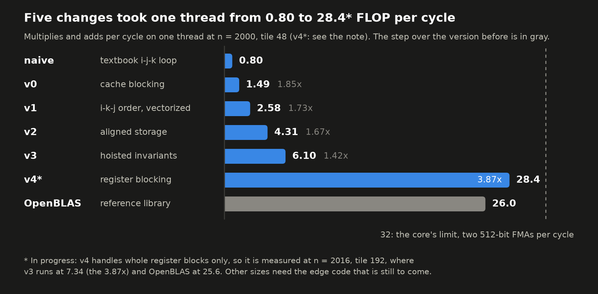
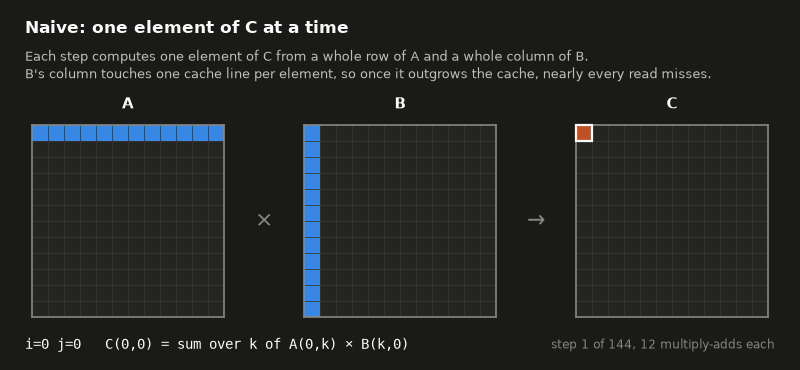
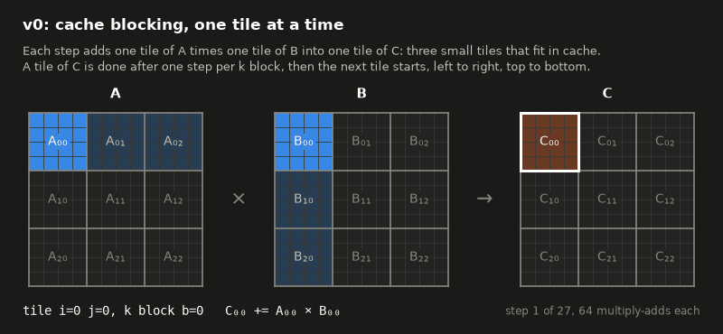
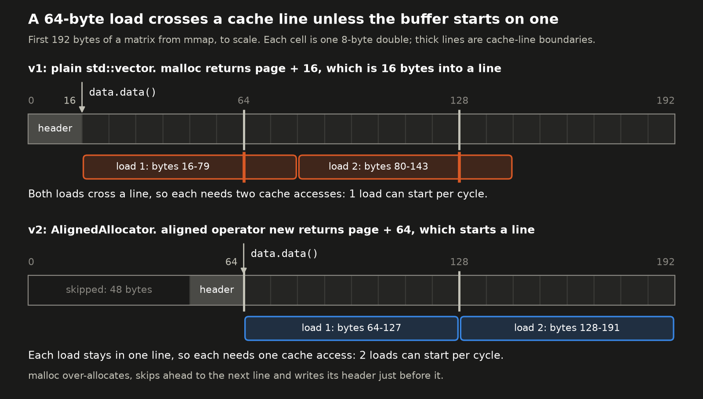
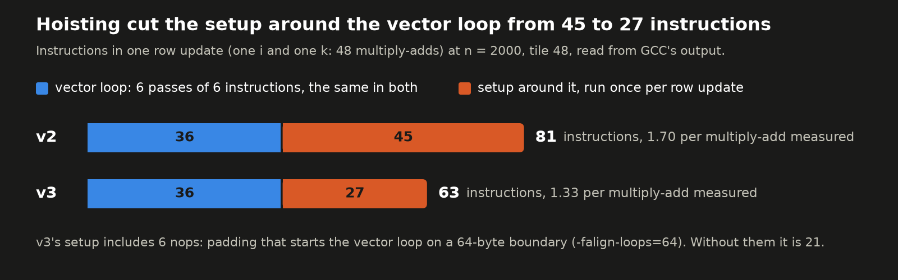
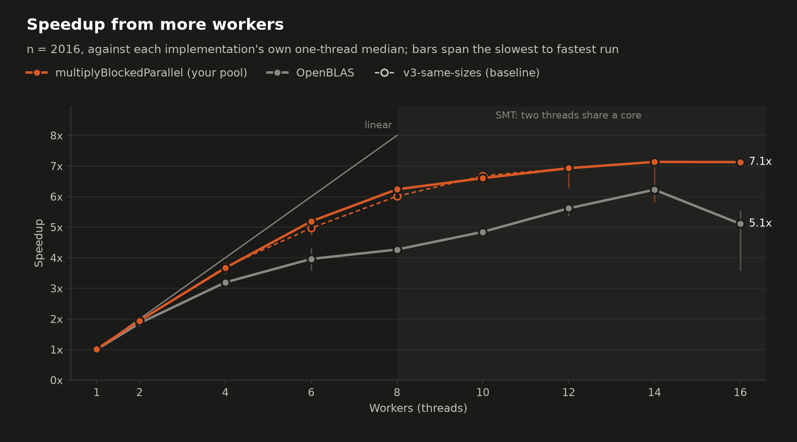
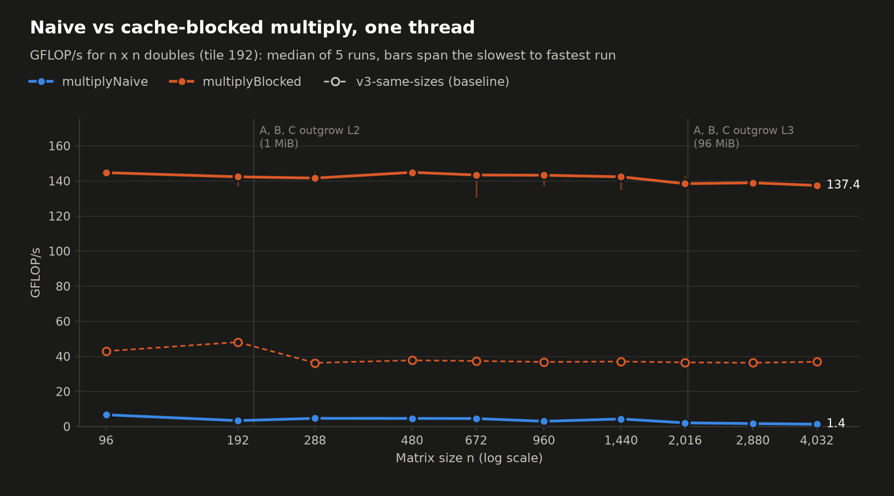
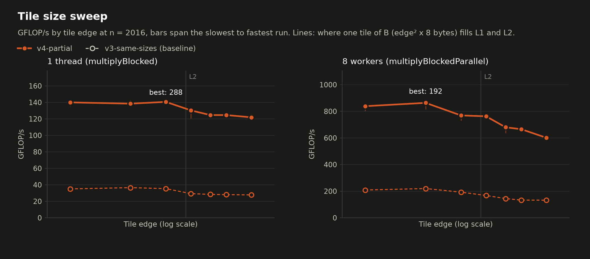

<div align="center">

# Matrix multiplication, one optimization at a time

A learning project: a hand-written thread pool, and a matmul kernel taken from the textbook
triple loop toward BLAS speed, one measured change per version.


[At a glance](#versions-at-a-glance) ·
[v0](#v0-cache-blocking) ·
[v1](#v1-loop-interchange) ·
[v2](#v2-cache-line-aligned-storage) ·
[v3](#v3-hoist-loop-invariants) ·
[v4*](#v4-register-blocking-in-progress) ·
[Thread pool](#the-thread-pool) ·
[Results](#results) ·
[Run it](#run-it) ·
[Method](#how-it-is-measured)

</div>



v3, the last finished version, is about **7.5x** faster than the naive loop on one thread and
**58x** faster on the pool's 16 workers, at about a quarter of OpenBLAS's speed.

**v4\*** is in progress. Its kernel so far handles only matrices made of whole register blocks. On
those it runs at **28 to 30 FLOP/cycle** on one thread from n = 192 to 2016, where OpenBLAS runs at
22 to 26. [What the asterisk covers](#v4-register-blocking-in-progress) is spelled out below.

The numbers for v0 to v3 come from [Google Benchmark](https://github.com/google/benchmark) with
hardware performance counters, and v4\*'s from a standalone check that uses the same counters, all
on a Ryzen 7 9800X3D.

## Versions at a glance

One thread, n = 2000, tile 48. FLOP/cycle counts multiplies and adds per CPU cycle; this core's
limit is 32.

| | What changed | FLOP/cycle | Step | Instructions per multiply-add | IPC |
|---|---|---:|---:|---:|---:|
| naive | Textbook i-j-k loop | 0.80 | | 7.01 | 2.82 |
| [v0](#v0-cache-blocking) | Work in 48 x 48 tiles, so the data in use stays in cache | 1.49 | 1.85x | 9.35 | 6.95 |
| [v1](#v1-loop-interchange) | Loop order i-k-j, which lets GCC vectorize with AVX-512 | 2.58 | 1.73x | 1.95 | 2.52 |
| [v2](#v2-cache-line-aligned-storage) | Matrices start on a 64-byte cache line | 4.31 | 1.67x | 1.70 | 3.67 |
| [v3](#v3-hoist-loop-invariants) | Loop invariants computed once, outside the loops | 6.10 | 1.42x | 1.33 | 4.05 |
| [v4\*](#v4-register-blocking-in-progress) | A 6 x 32 block of C stays in registers for a whole k block | 28.4\* | 3.87x\* | 0.20 | 2.85 |
| OpenBLAS | Reference: hand-written AVX-512 kernels | 26.0 | | 0.23 | 2.94 |

\* v4 is in progress and handles whole register blocks only, which n = 2000 and tile 48 are not.
Its row is n = 2016, tile 192, from `make v4-fullblock`, where v3 runs at 7.34 FLOP/cycle and
OpenBLAS at 25.6.

Each section below has the same parts: what changed, what it bought, why, and the bottleneck it
left for the next version.

## v0: cache blocking

`multiplyNaive` reads a whole column of B for every element of C, so from about n = 1000 nearly
every multiply-add misses L1.



`multiplyBlocked` finishes C one tile at a time instead. Each step adds one tile of A times one
tile of B into a tile of C, and at tile 48 a tile is 18 KiB. `multiplyBlockedParallel` runs the
same tiles of C as tasks on the thread pool.



**Result.** At n = 2000, L1 misses per multiply-add drop from 1.09 to 0.014, and FLOP/cycle rises
from 0.80 to 1.49 (1.85x). Blocked holds about 7 GFLOP/s from n = 100 to 4000, while naive falls
from 6.22 to 1.12.

> [!NOTE]
> **Next bottleneck.** The inner loop is scalar. It does one multiply-add per pass, and each add
> waits for the one before it. IPC is a high 6.95, but that buys only 1.49 FLOP/cycle.

## v1: loop interchange

One change in `multiplyBlock`: the order of the loops inside a tile. The innermost loop now walks
along a row of C instead of summing down a column of B.

```
v0:  for i, for j:   sum = 0;  for k: sum += A[i][k] * B[k][j];  C[i][j] += sum
v1:  for i, for k:   for j: C[i][j] += A[i][k] * B[k][j]
```


**Result.** 1.49 to 2.58 FLOP/cycle (1.73x) on one thread, and 59.9 to 99.4 GFLOP/s on 16 workers.

**Why.**

- **The inner loop vectorizes.** GCC left v0's loop scalar for three reasons: the tail `break`
  gave it an early exit, it summed into one variable (vectorizing that reorders the additions,
  which GCC does only with `-ffast-math`), and it read B down a column, a whole row apart in
  memory. v1 reads a row of B and a row of C, both contiguous, and gives each j its own element of
  C, so nothing is reordered. GCC compiles it to 512-bit instructions, 8 doubles each.
- **The add chain is gone, but that alone bought nothing.** v0's chains were only 48 adds long and
  the out-of-order core already overlapped them. Built without SIMD, v1 is slower than v0: 3.04
  against 7.04 GFLOP/s. What the independent elements of C give is permission to vectorize.
- **IPC fell from 6.95 to 2.52, and that is fine.** One vector instruction does 8 multiply-adds,
  so v1 runs 4.8x fewer instructions per multiply-add in 1.7x fewer cycles. Compare versions by
  FLOP/cycle, not IPC.

<details>
<summary><b>The two hot loops, from <code>objdump</code></b></summary>

`sd` = scalar double, `pd` = packed double, `zmm` = 512 bits. v0 does one multiply-add per pass.
GCC's Zen tuning splits it into `vmulsd` + `vaddsd` to keep the 4-cycle FMA out of the add chain:

```
inc     %rax                      # k++
add     %rcx,%rdx                 # B pointer += one row
cmp     %rsi,%rax                 # the tail check
jae     ...
vmovsd  (%r15,%rax,8),%xmm0       # A[i][k]
vmulsd  (%rdx),%xmm0,%xmm0        # × B[k][j]
vaddsd  %xmm0,%xmm1,%xmm1         # sum += ...   (xmm1 on every pass: the chain)
cmp     %rdi,%rax                 # end of the k block?
jne     ...
```

v1 does eight per pass, and with no chain it gets a real FMA:

```
vbroadcastsd (%r8),%zmm3                # before the loop: A[i][k] in all 8 lanes
vmovupd      (%r10,%r9,1),%zmm1         # 8 doubles of B's row k
vfmadd213pd  (%rdx,%r9,1),%zmm3,%zmm1   # × A[i][k], + 8 doubles of C's row i
vmovupd      %zmm1,(%rdx,%r9,1)         # store them to C
add          $0x40,%r9                  # next 64 bytes
cmp          %r9,0x110(%rsp)
jne          ...
```

</details>

> [!NOTE]
> **Next bottleneck.** `std::vector` puts these matrices 16 bytes past a 64-byte boundary, so
> every 64-byte load and store straddles two cache lines. Of v1's 5 repetitions, 2 ran at
> 16.8 GFLOP/s, when C happened to land on a boundary, and 3 at 12.1.

## v2: cache-line-aligned storage

No change to the source of `multiplyBlock`, only to where the matrices live. `Matrix::data` now
uses an `AlignedAllocator` ([include/matmul.hpp](include/matmul.hpp)) that asks aligned
`operator new` for 64-byte alignment, so every matrix starts on a cache line.



**Result.** 2.58 to 4.31 FLOP/cycle (1.67x). The run-to-run variation (CV) drops from 17.3% to
0.8%: v1's two speeds are gone.

**Why.**

- **Where the 16 bytes came from.** glibc's `malloc` puts a 16-byte header just before the
  pointer it returns, and it gives a large block fresh pages from `mmap`. So the data starts at
  page + 16, which is 16 bytes into a cache line.
- **What that costs.** The kernel loads 8 doubles at a time, and from that offset every 64-byte
  load needs two cache accesses. The core can start two aligned loads per cycle but only one
  split load (measured: 0.50 and 1.00 cycles per load), and v1 does two loads per vector FMA.
- **Why v1 ran at two speeds.** After the first large `free`, glibc raises its `mmap` threshold,
  and later matrices come from the ordinary heap at whatever multiple of 16 its history leaves. C
  alternated between 0 and 16 mod 64.
- **The check.** The same v2 object files, linked with an `operator new` that returns 16 mod 64
  on purpose, ran at 2.61 FLOP/cycle against 4.30, with identical instruction counts.
- **Not every size gets the full gain.** All rows start on a line only when n is a multiple of 8.
  At n = 100, 300, 500, 700 and 1500 every other row starts 32 bytes into a line, and those sizes
  reach 2.8-3.3 FLOP/cycle against 4.0-4.4 elsewhere.

> [!NOTE]
> **Next bottleneck.** Each pass of the k loop updates one row of a tile: 48 multiply-adds. v2
> runs 81 instructions for it, and only 36 of them are the vector loop. The rest is setup that
> GCC repeats every time.

## v3: hoist loop invariants

`multiplyBlock` computes the same thing in the same loop order. Values that stay the same through
an inner loop are now worked out once, before it:

- the data pointers of A, B and C and the widths of A and B, read from the `Matrix` objects once
- the end of each k block, computed once with `std::min` instead of an `if (...) break` on every k
- the row pointers of A and C, once per i
- `A[i][k]` and the row pointer of B, once per k, before the j loop



**Result.** 4.31 to 6.10 FLOP/cycle (1.42x) on one thread, and 167 to 233 GFLOP/s on 16 workers.

**Why.** The vector loop is the same 6 instructions per 8 columns as in v1 and v2. What shrank is
the setup GCC runs around it once per row update (one i and one k, which at tile 48 is 48
multiply-adds, or 6 passes of the vector loop):

| Instructions per row update | v2 | v3 |
|---|---:|---:|
| Vector loop, 6 passes of 6 | 36 | 36 |
| Overlap checks | 14 | 5 |
| Reloads and spills | 9 | 2 |
| Length checks | 8 | 6 |
| Address arithmetic | 7 | 3 |
| Loop control | 6 | 3 |
| Load `A[i][k]` into all 8 lanes | 1 | 2 |
| Padding (`nop`) | 0 | 6 |
| **Total** | **81** | **63** |
| Total / 48 multiply-adds | 1.69 | 1.31 |
| Measured per multiply-add | 1.70 | 1.33 |

- **Overlap checks, 14 to 5.** GCC cannot prove that storing to C's row leaves `A[i][k]` and B's
  row unchanged, so before the vector loop it checks that they don't overlap. Copied into a
  local, `A[i][k]` needs no check, which leaves only B's row against C's.
- **Reloads and spills, 9 to 2.** On every row update v2 read `&A` and `&B` from the stack, then
  `A.data`, `B.data` and `B.cols` from the `Matrix` objects. v3 reads the objects once per call.
- **Address arithmetic and loop control, 13 to 6.** v2 multiplied k by B's width on every row
  update and tested two ways out of the k loop. v3 steps its pointers by a fixed amount and has
  one test.
- **Cycles fell further than instructions:** 30% fewer cycles per multiply-add against 22% fewer
  instructions. The setup that went away had been holding the FMAs up, not running beside them.

The 6 `nop`s are padding from `-falign-loops=64`, which starts the vector loop on a 64-byte
boundary.

> [!NOTE]
> **Next bottleneck.** C still makes a round trip through memory for every k: two loads and a
> store per vector FMA. v3 reaches 6.10 of a possible 32 FLOP/cycle.

## v4: register blocking (in progress)

`multiplyBlock` is now written with AVX-512 intrinsics. It keeps a 6 x 32 block of C in 24 `zmm`
registers for a whole k block: loaded once, updated by 24 FMAs for each k, and stored once.

```
v3:  for i, for k:
         for j, 8 at a time:   C[i][j] += A[i][k] * B[k][j]        C is loaded and stored for every FMA

v4:  for i, 6 at a time:   for j, 32 at a time:
         load the 6 x 32 block of C into 24 registers
         for k:   every register += its row's A[i][k] * its 8 columns of B[k]
         store the 24 registers
```

**Result\*.** On matrices made of whole register blocks, 28 to 30 FLOP/cycle on one thread, against
7.3 to 7.5 for v3's kernel at n = 960 to 2016 with the same tile. One thread, tile 192, FLOP/cycle:

| n | v4\* | OpenBLAS | v4\* / OpenBLAS |
|---|---:|---:|---:|
| 96 (tile 96) | 25.90 | 29.58 | 0.88x |
| 192 | 30.07 | 22.28 | 1.35x |
| 480 | 30.38 | 24.79 | 1.23x |
| 960 | 30.24 | 25.34 | 1.19x |
| 1920 | 28.90 | 25.51 | 1.13x |
| 2016 | 28.42 | 25.62 | 1.11x |

**Why.**

- **C stays out of memory.** v3 did two loads and a store for every vector FMA. One pass of v4's k
  loop does 24 FMAs with 10 loads and no store: 6 values of A, one per row of the block, and 4
  vectors of B, one per 8 columns.
- **Fewer instructions.** That pass is 38 instructions for 192 multiply-adds, 0.20 each, against
  v3's 1.33 at tile 48 and 0.89 at tile 192.
- **Enough FMAs in flight.** The core can start 2 FMAs per cycle and each takes 4 cycles, so it
  needs at least 8 that do not wait on each other. The 24 registers are 24 separate chains.
- **It just fits.** 24 registers of C, 6 of A and 1 of B make 31 of the 32 `zmm` registers. The
  compiled k loop never touches the stack.

<details>
<summary><b>The k loop, from <code>objdump</code></b></summary>

One pass, for one k. `zmm0` is the vector of B, `zmm1` to `zmm6` are the 6 values of A, and the
other 24 registers are the block of C:

```
vmovupd      zmm0,[rcx]              # B[k], columns j to j+7
vbroadcastsd zmm6,[rsi+rax*8]        # column k of A in all 8 lanes, for one row of the block
vbroadcastsd zmm5,[r13+rax*8]        # and for the other 5 rows
vbroadcastsd zmm4,[r10+rax*8]
vbroadcastsd zmm3,[r11+rax*8]
vbroadcastsd zmm2,[rbx+rax*8]
vbroadcastsd zmm1,[r12+rax*8]
inc          rax                     # k++
vfmadd231pd  zmm12,zmm6,zmm0         # 6 rows of C, columns j to j+7
vfmadd231pd  zmm9,zmm5,zmm0
vfmadd231pd  zmm23,zmm4,zmm0
vfmadd231pd  zmm24,zmm3,zmm0
vfmadd231pd  zmm18,zmm2,zmm0
vfmadd231pd  zmm25,zmm1,zmm0
vmovupd      zmm0,[rcx+0x40]         # B[k], columns j+8 to j+15
...                                  # 6 more FMAs, and the same again for j+16 and j+24
add          rcx,r9                  # B pointer += one row
cmp          rdx,rax                 # end of the k block?
jne          ...
```

</details>

> [!WARNING]
> **What the asterisk covers.**
> - **Whole register blocks only.** The kernel is correct when every tile's height is a multiple
>   of 6 and its width a multiple of 32, so n and the tile must be multiples of 96. The code for
>   the leftover rows and columns is not written yet. At any other size `multiplyBlocked` and
>   `multiplyBlockedParallel` on this branch return wrong results, and `make test` fails.
> - **A different harness.** The benchmark suite's sizes are not multiples of 96, so these numbers
>   come from `make v4-fullblock` ([experiments/v4_fullblock.cpp](experiments/v4_fullblock.cpp)).
>   It times the kernel and one-thread OpenBLAS in one process, calls interleaved, both adding
>   A x B into a result that is already allocated. Each number is the median, and every result
>   is checked element by element.
> - **Small matrices.** At n = 96 OpenBLAS is ahead, 29.6 against 25.9.
> - **One thread only.** The [thread pool](#the-thread-pool) and [Results](#results) sections
>   below are still v3.

**Still to do.** The edge code, then a full run of the suite, a new default tile, and the pool.

## The thread pool

`Threadpool` ([include/threadpool.hpp](include/threadpool.hpp)) is a fixed set of workers that
take `std::function` tasks from one shared queue, with `enqueue` and `waitAll`.
`multiplyBlockedParallel` enqueues one task per tile of C, so no two tasks write the same elements.



With v3's kernel at n = 2000, 8 workers run 5.6x faster than the single-threaded code and 16
workers 7.8x, on 8 cores with 2 hardware threads each. OpenBLAS gets 6.7x from the same 16
threads. Between 1 and 16 workers the busy cores' clock drops from 5.08 to 4.57 GHz and L1 misses
per multiply-add rise from 0.011 to 0.030.

## Results


These are v3's results. v4 joins the suite when it handles every size.

Every table uses tile 48 so that the versions line up, but the best tile has moved as the kernel
changed: 48 for v0, 256 for v1 and v2, and 192 for v3 (7.64 FLOP/cycle). A longer row spreads each
row's setup over more vector FMAs, until B's tile no longer fits in the 1 MiB L2.

<details>
<summary><b>Every chart and table from the latest run</b> (by matrix size, thread scaling, tile sweep)</summary>

<!-- results:start -->

## Benchmark results: v3

- Machine: AMD Ryzen 7 9800X3D 8-Core Processor; 8 cores, 16 hardware threads; L1d 48 KiB and L2 1 MiB per core, L3 96 MiB shared by all 8 cores
- Build: gcc 13.3.0, `-std=c++20 -Wall -Wextra -Iinclude -pthread -O3 -march=native -g -falign-loops=64`, git v3
- Reference: OpenBLAS 0.3.26 NO_LAPACKE DYNAMIC_ARCH NO_AFFINITY Cooperlake MAX_THREADS=64 core=Cooperlake
- Run: 2026-11-14T02:44:08-07:00, median of 5 repetitions, wall-clock time, every result checked with Freivalds' algorithm
- Baseline: v2, run 2026-11-04T03:46:31-07:00. The charts draw its blocked kernels as hollow markers and dashed lines; "vs v2" columns are speedups over it.

### Headline: n = 2000, tile 48


| Implementation | Threads | Time (ms) | GFLOP/s | vs naive | vs v2 | vs OpenBLAS, same threads | CV |
|---|---:|---:|---:|---:|---:|---:|---:|
| multiplyNaive | 1 | 3,979 | 4.02 | 1x | - | 3.2% | 6.9% |
| multiplyBlocked | 1 | 533 | 30 | 7.47x | 1.34x | 23.9% | 7.3% |
| multiplyBlockedParallel | 8 | 95.1 | 168 | 41.8x | 1.46x | 31.5% | 8.0% |
| multiplyBlockedParallel | 16 | 68.6 | 233 | 58x | 1.39x | 27.7% | 13.8% |
| OpenBLAS dgemm | 1 | 127 | 126 | 31.3x | - | 100.0% | 1.0% |
| OpenBLAS dgemm | 8 | 30 | 534 | 133x | - | 100.0% | 5.5% |
| OpenBLAS dgemm | 16 | 19 | 842 | 209x | - | 100.0% | 56.4% |

### By matrix size, one thread




GFLOP/s, then hardware-counter events per multiply-add (N = naive, B = blocked).

| n | Naive | Blocked | Blocked / naive | Blocked vs v2 | OpenBLAS | L1D miss N | L1D miss B | L2 miss N | L2 miss B | DRAM fill N | DRAM fill B |
|---|---:|---:|---:|---:|---:|---:|---:|---:|---:|---:|---:|
| 100 | 6.29 | 20.1 | 3.20x | 1.37x | 146 | 0.132 | 0.0202 | 9.79e-05 | 2.74e-05 | 1.58e-06 | 4.98e-07 |
| 200 | 5.87 | 28.2 | 4.80x | 1.37x | 111 | 0.13 | 0.014 | 0.000607 | 0.000249 | 6.42e-06 | 1.32e-07 |
| 300 | 5.43 | 22.8 | 4.21x | 1.40x | 113 | 0.134 | 0.0134 | 0.000978 | 0.00094 | 2.17e-05 | 4.42e-06 |
| 500 | 5.11 | 23.4 | 4.59x | 1.37x | 120 | 0.158 | 0.0134 | 0.0276 | 0.00116 | 5.37e-05 | 8.95e-06 |
| 700 | 4.95 | 23.2 | 4.68x | 1.36x | 123 | 0.552 | 0.0123 | 0.0493 | 0.00146 | 0.000146 | 0.000105 |
| 1000 | 4.16 | 30.4 | 7.29x | 1.33x | 125 | 1.13 | 0.0111 | 0.0214 | 0.00128 | 1.36e-05 | 2.71e-05 |
| 1500 | 4.02 | 23.4 | 5.84x | 1.40x | 125 | 1.13 | 0.0126 | 0.0461 | 0.00229 | 4.93e-05 | 2.33e-05 |
| 2000 | 4.02 | 30 | 7.47x | 1.34x | 126 | 1.09 | 0.0112 | 0.0654 | 0.00178 | 0.00011 | 7.27e-05 |
| 3000 | 1.92 | 29.2 | 15.20x | 1.35x | 126 | 1.13 | 0.0109 | 0.0676 | 0.00224 | 0.00702 | 0.000362 |
| 4000 | 1.22 | 28.5 | 23.40x | 1.36x | 130 | 1.16 | 0.011 | 0.633 | 0.00182 | 0.0734 | 0.00129 |

### Thread scaling: n = 2000, tile 48


Speedup is against single-threaded multiplyBlocked; efficiency divides it by the physical cores in use (at most 8). GHz is the average clock of the busy cores; IPC is per hardware thread.

| Workers | Time (ms) | GFLOP/s | vs v2 | Speedup | Efficiency | GHz | IPC | L1D miss/FMA | OpenBLAS GFLOP/s | OpenBLAS speedup |
|---|---:|---:|---:|---:|---:|---:|---:|---:|---:|---:|
| 1 | 524 | 30.5 | 1.63x | 1.02 | 102% | 5.08 | 4.11 | 0.011 | 126 | 1 |
| 2 | 294 | 54.4 | 1.62x | 1.81 | 90% | 4.96 | 3.74 | 0.013 | 232 | 1.84 |
| 4 | 161 | 99.6 | 1.54x | 3.32 | 83% | 4.99 | 3.61 | 0.0139 | 408 | 3.25 |
| 6 | 111 | 144 | 1.54x | 4.78 | 80% | 4.9 | 3.5 | 0.0149 | 488 | 3.88 |
| 8 | 95.1 | 168 | 1.46x | 5.6 | 70% | 4.76 | 3.17 | 0.0179 | 534 | 4.24 |
| 10 | 81.7 | 196 | 1.48x | 6.52 | 81% | 4.75 | 3.02 | 0.0198 | 628 | 5 |
| 12 | 79.9 | 200 | 1.38x | 6.67 | 83% | 4.72 | 2.58 | 0.026 | 710 | 5.65 |
| 14 | 73.2 | 219 | 1.40x | 7.28 | 91% | 4.59 | 2.56 | 0.0282 | 815 | 6.48 |
| 16 | 68.6 | 233 | 1.39x | 7.77 | 97% | 4.57 | 2.42 | 0.0301 | 842 | 6.7 |

### Tile sweep: n = 2000



| Tile | 1 thread GFLOP/s | vs v2 | IPC | L1D miss/FMA | L2 miss/FMA | 8 workers GFLOP/s | vs v2 |
|---|---:|---:|---:|---:|---:|---:|---:|
| 8 | 11.3 | 1.52x | 5.29 | 0.0375 | 0.00915 | 72.3 | 1.62x |
| 16 | 16 | 1.34x | 4.11 | 0.0198 | 0.00582 | 100 | 1.53x |
| 24 | 19.9 | 1.28x | 3.93 | 0.0141 | 0.00589 | 104 | 1.37x |
| 32 | 23.5 | 1.28x | 3.85 | 0.0147 | 0.00399 | 129 | 1.37x |
| 48 | 30 | 1.34x | 4.05 | 0.0112 | 0.00178 | 168 | 1.46x |
| 64 | 35.1 | 1.47x | 4.22 | 0.0146 | 0.00238 | 189 | 1.49x |
| 96 | 34.5 | 1.52x | 3.81 | 0.13 | 0.00197 | 202 | 1.49x |
| 128 | 35.9 | 1.46x | 3.62 | 0.129 | 0.00178 | 212 | 1.40x |
| 192 | 36.6 | 1.38x | 3.44 | 0.127 | 0.00156 | 216 | 1.26x |
| 256 | 35.5 | 1.26x | 3.21 | 0.129 | 0.00158 | 202 | 1.08x |
| 384 | 30.1 | 1.17x | 2.59 | 0.135 | 0.0246 | 159 | 1.05x |
| 512 | 27.7 | 1.10x | 2.29 | 0.139 | 0.0918 | 131 | 1.01x |

<!-- results:end -->

</details>

## Run it

```sh
sudo apt install libgtest-dev libbenchmark-dev libbenchmark-tools libopenblas-dev

make && make run      # the demo app, build/app
make test             # GoogleTest suites for the pool and every multiply
make bench-quick      # one repetition of the benchmarks, about 2 minutes
make bench-run        # the full run, about 20 minutes, saved to bench/results/<label>.json
make bench-plot       # charts and tables from that file
```

OpenBLAS is optional. [bench/README.md](bench/README.md) has the rest: every command and option,
the AOCL-BLAS reference suite, comparing two versions, and what each counter means.

## How it is measured

- **Machine.** AMD Ryzen 7 9800X3D: 8 Zen 5 cores, 16 hardware threads, 48 KiB L1D and 1 MiB L2
  per core, 96 MiB of shared L3. GCC 13.3 with `-O3 -march=native`, Ubuntu under WSL2.
- **The limit.** A core can start two 512-bit FMAs per cycle. Each does 8 multiplies and 8 adds,
  which makes 32 FLOP/cycle.
- **Timing.** Wall-clock time on `CLOCK_MONOTONIC_RAW`, the median of 5 repetitions interleaved
  across the whole suite. GFLOP/s = 2n³ / time.
- **Every result is checked** with Freivalds' algorithm after timing, so a fast but broken kernel
  cannot post a number.
- **Counters** come from `perf_event_open` around the timed loop, reported per multiply-add:
  instructions, cycles, L1 and L2 misses, L3 and DRAM fills.
- **Compare versions by FLOP/cycle.** Runs up to v3 used a clock that WSL2 adjusts, so their
  GFLOP/s shift by up to 10% between sessions. Their FLOP/cycle does not.
- **No power-of-two sizes.** At n = 1024 and 2048 these kernels ran 5-6x slower, most likely from
  cache-set conflicts, which would hide every other effect.

The full methodology and its noise notes are in [bench/README.md](bench/README.md).

## Repository layout

| Path | Contents |
|---|---|
| [include/](include/), [src/](src/) | `Threadpool`, `Matrix` and the multiply variants |
| [tests/](tests/) | GoogleTest suites |
| [bench/](bench/) | Benchmark harness, hardware counters, `plot.py`, results and charts |
| [docs/](docs/) | The GIFs and diagrams on this page, each with the script that draws it |
| [experiments/](experiments/) | Standalone programs that each measure one CPU effect |
| [exercises/register_blocking/](exercises/register_blocking/) | Toy problems that lead up to v4 |
