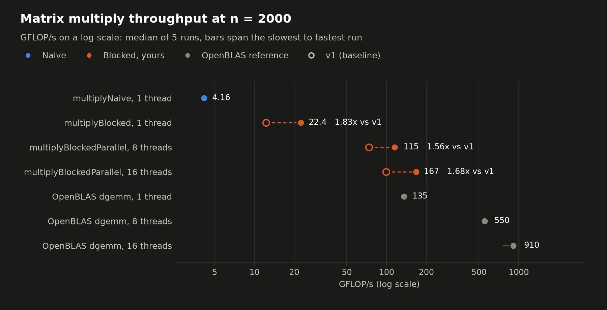
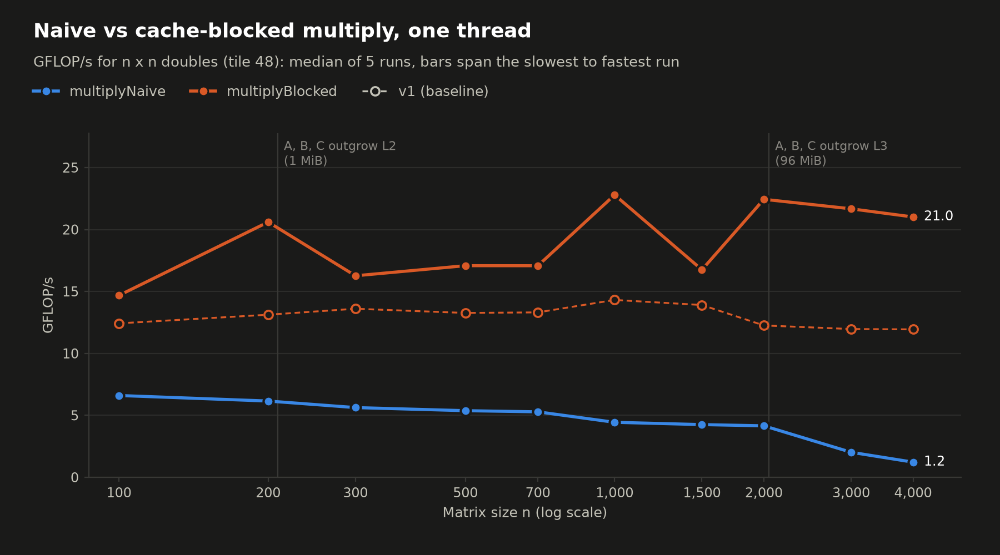
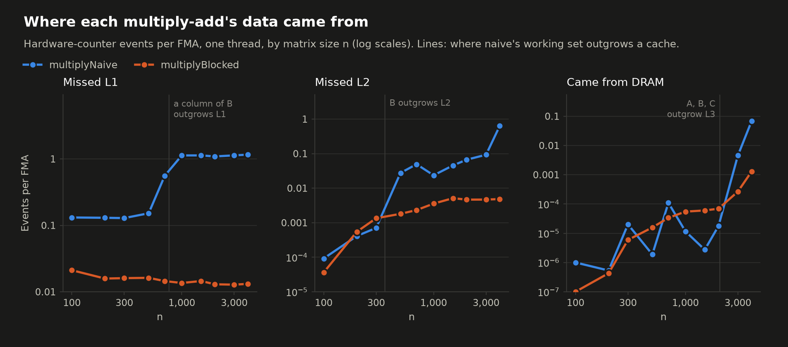
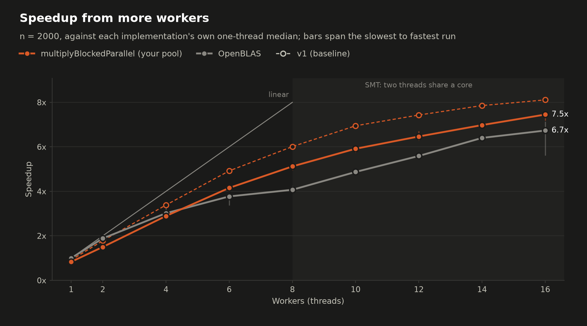
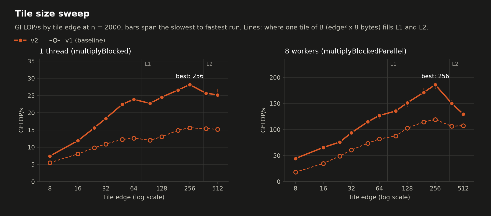

# Benchmark results: v2

- Machine: AMD Ryzen 7 9800X3D 8-Core Processor; 8 cores, 16 hardware threads; L1d 48 KiB and L2 1 MiB per core, L3 96 MiB shared by all 8 cores
- Build: gcc 13.3.0, `-std=c++20 -Wall -Wextra -Iinclude -pthread -O3 -march=native -g -falign-loops=64`, git v2
- Reference: OpenBLAS 0.3.26 NO_LAPACKE DYNAMIC_ARCH NO_AFFINITY Cooperlake MAX_THREADS=64 core=Cooperlake
- Run: 2026-11-04T03:46:31-07:00, median of 5 repetitions, wall-clock time, every result checked with Freivalds' algorithm
- Baseline: v1, run 2026-10-24T17:31:44-07:00. The charts draw its blocked kernels as hollow markers and dashed lines; "vs v1" columns are speedups over it.

## Headline: n = 2000, tile 48

| Implementation | Threads | Time (ms) | GFLOP/s | vs naive | vs v1 | vs OpenBLAS, same threads | CV |
|---|---:|---:|---:|---:|---:|---:|---:|
| multiplyNaive | 1 | 3,851 | 4.16 | 1x | - | 3.1% | 1.7% |
| multiplyBlocked | 1 | 713 | 22.4 | 5.4x | 1.83x | 16.6% | 0.8% |
| multiplyBlockedParallel | 8 | 139 | 115 | 27.6x | 1.56x | 20.9% | 2.3% |
| multiplyBlockedParallel | 16 | 95.7 | 167 | 40.2x | 1.68x | 18.4% | 1.7% |
| OpenBLAS dgemm | 1 | 118 | 135 | 32.5x | - | 100.0% | 1.7% |
| OpenBLAS dgemm | 8 | 29.1 | 550 | 132x | - | 100.0% | 2.2% |
| OpenBLAS dgemm | 16 | 17.6 | 910 | 219x | - | 100.0% | 11.6% |

## By matrix size, one thread

GFLOP/s, then hardware-counter events per multiply-add (N = naive, B = blocked).

| n | Naive | Blocked | Blocked / naive | Blocked vs v1 | OpenBLAS | L1D miss N | L1D miss B | L2 miss N | L2 miss B | DRAM fill N | DRAM fill B |
|---|---:|---:|---:|---:|---:|---:|---:|---:|---:|---:|---:|
| 100 | 6.6 | 14.7 | 2.22x | 1.18x | 156 | 0.131 | 0.0211 | 9.21e-05 | 3.62e-05 | 1e-06 | 1e-07 |
| 200 | 6.16 | 20.6 | 3.35x | 1.57x | 118 | 0.13 | 0.0158 | 0.000411 | 0.000545 | 5.34e-07 | 4.31e-07 |
| 300 | 5.63 | 16.3 | 2.89x | 1.20x | 122 | 0.129 | 0.0161 | 0.000706 | 0.00135 | 2.01e-05 | 5.92e-06 |
| 500 | 5.38 | 17.1 | 3.18x | 1.29x | 127 | 0.152 | 0.0162 | 0.0276 | 0.00181 | 1.89e-06 | 1.58e-05 |
| 700 | 5.28 | 17.1 | 3.23x | 1.28x | 128 | 0.558 | 0.0145 | 0.0493 | 0.00232 | 0.00011 | 3.37e-05 |
| 1000 | 4.44 | 22.8 | 5.14x | 1.59x | 133 | 1.13 | 0.0136 | 0.0236 | 0.00357 | 1.16e-05 | 5.5e-05 |
| 1500 | 4.25 | 16.7 | 3.94x | 1.20x | 134 | 1.13 | 0.0145 | 0.0456 | 0.00513 | 2.74e-06 | 6.04e-05 |
| 2000 | 4.16 | 22.4 | 5.40x | 1.83x | 135 | 1.09 | 0.013 | 0.0668 | 0.00466 | 1.77e-05 | 6.92e-05 |
| 3000 | 2.02 | 21.7 | 10.73x | 1.81x | 135 | 1.13 | 0.0128 | 0.0928 | 0.00468 | 0.00455 | 0.000266 |
| 4000 | 1.22 | 21 | 17.18x | 1.76x | 137 | 1.16 | 0.0132 | 0.638 | 0.00484 | 0.0684 | 0.00129 |

## Thread scaling: n = 2000, tile 48

Speedup is against single-threaded multiplyBlocked; efficiency divides it by the physical cores in use (at most 8). GHz is the average clock of the busy cores; IPC is per hardware thread.

| Workers | Time (ms) | GFLOP/s | vs v1 | Speedup | Efficiency | GHz | IPC | L1D miss/FMA | OpenBLAS GFLOP/s | OpenBLAS speedup |
|---|---:|---:|---:|---:|---:|---:|---:|---:|---:|---:|
| 1 | 857 | 18.7 | 1.66x | 0.832 | 83% | 5.12 | 3.34 | 0.0128 | 135 | 1 |
| 2 | 476 | 33.6 | 1.54x | 1.5 | 75% | 5.04 | 3.06 | 0.0247 | 255 | 1.89 |
| 4 | 247 | 64.9 | 1.56x | 2.89 | 72% | 5 | 3.02 | 0.0253 | 408 | 3.02 |
| 6 | 172 | 93.2 | 1.55x | 4.15 | 69% | 4.96 | 2.98 | 0.0271 | 510 | 3.77 |
| 8 | 139 | 115 | 1.56x | 5.12 | 64% | 4.87 | 2.81 | 0.0354 | 550 | 4.07 |
| 10 | 121 | 133 | 1.56x | 5.91 | 74% | 4.83 | 2.62 | 0.0464 | 658 | 4.87 |
| 12 | 110 | 145 | 1.59x | 6.47 | 81% | 4.82 | 2.41 | 0.0601 | 755 | 5.59 |
| 14 | 102 | 157 | 1.63x | 6.98 | 87% | 4.79 | 2.25 | 0.0727 | 865 | 6.4 |
| 16 | 95.7 | 167 | 1.68x | 7.45 | 93% | 4.76 | 2.11 | 0.0847 | 910 | 6.73 |

## Tile sweep: n = 2000

| Tile | 1 thread GFLOP/s | vs v1 | IPC | L1D miss/FMA | L2 miss/FMA | 8 workers GFLOP/s | vs v1 |
|---|---:|---:|---:|---:|---:|---:|---:|
| 8 | 7.45 | 1.36x | 4.77 | 0.0347 | 0.00962 | 44.5 | 2.45x |
| 16 | 11.9 | 1.48x | 4.17 | 0.0194 | 0.00835 | 65.7 | 1.88x |
| 24 | 15.6 | 1.59x | 4.03 | 0.016 | 0.00875 | 76 | 1.55x |
| 32 | 18.4 | 1.68x | 3.92 | 0.0153 | 0.00692 | 93.9 | 1.54x |
| 48 | 22.4 | 1.83x | 3.67 | 0.013 | 0.00466 | 115 | 1.56x |
| 64 | 23.9 | 1.89x | 3.42 | 0.0214 | 0.00367 | 127 | 1.55x |
| 96 | 22.7 | 1.89x | 2.7 | 0.151 | 0.00236 | 136 | 1.55x |
| 128 | 24.6 | 1.88x | 2.66 | 0.142 | 0.00218 | 152 | 1.48x |
| 192 | 26.6 | 1.78x | 2.56 | 0.134 | 0.00197 | 171 | 1.49x |
| 256 | 28.2 | 1.80x | 2.56 | 0.133 | 0.00322 | 186 | 1.56x |
| 384 | 25.7 | 1.67x | 2.22 | 0.145 | 0.0864 | 151 | 1.42x |
| 512 | 25.2 | 1.66x | 2.09 | 0.142 | 0.12 | 130 | 1.21x |
