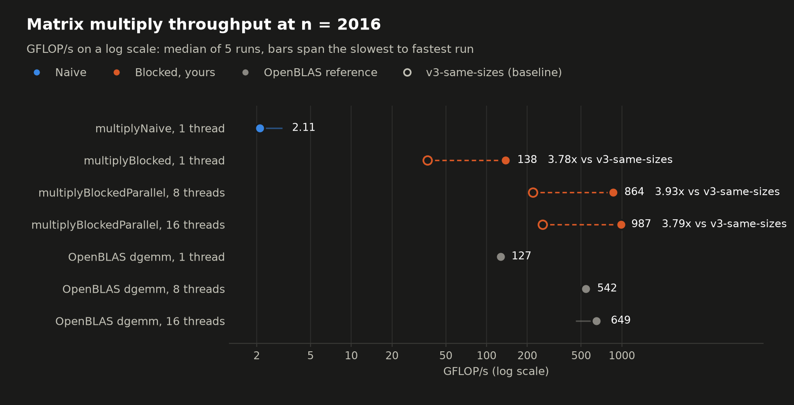
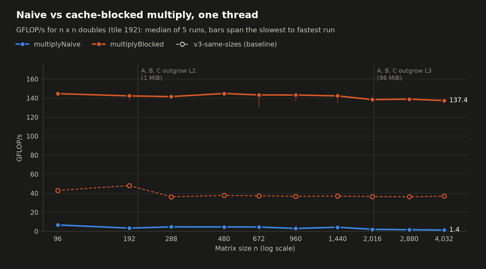
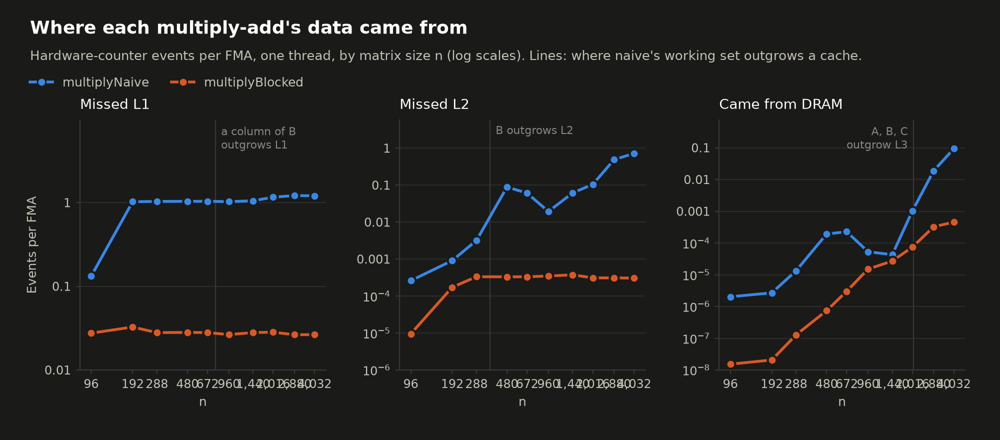
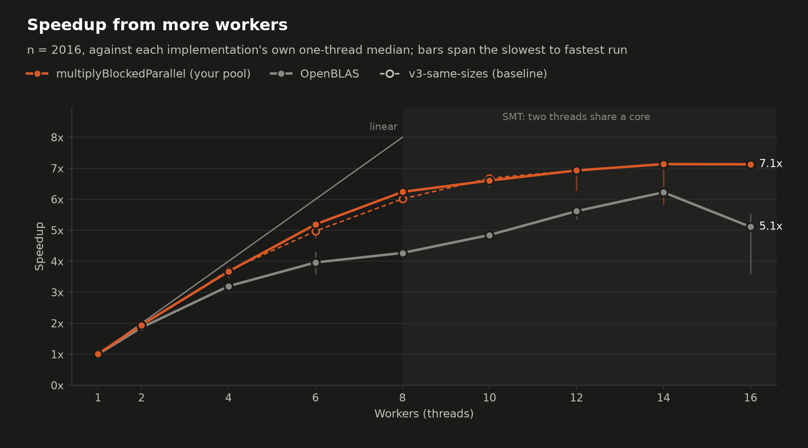
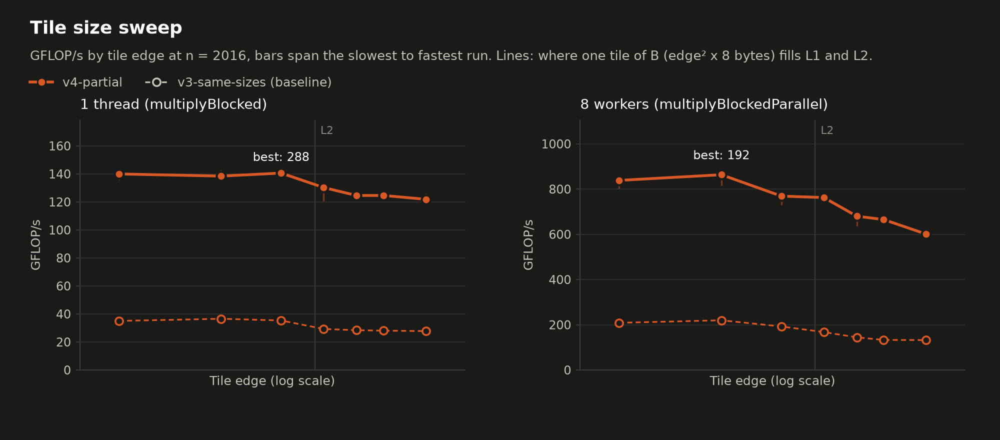

# Benchmark results: v4-partial

- Machine: AMD Ryzen 7 9800X3D 8-Core Processor; 8 cores, 16 hardware threads; L1d 48 KiB and L2 1 MiB per core, L3 96 MiB shared by all 8 cores
- Build: gcc 13.3.0, `-std=c++20 -Wall -Wextra -Iinclude -pthread -O3 -march=native -g -falign-loops=64`, git v4-partial
- Reference: OpenBLAS 0.3.26 NO_LAPACKE DYNAMIC_ARCH NO_AFFINITY Cooperlake MAX_THREADS=64 core=Cooperlake
- Run: 2026-11-23T20:31:16-07:00, median of 5 repetitions, wall-clock time on the raw clock (CPU / wall on one thread: 1.00), every result checked with Freivalds' algorithm
- Baseline: v3-same-sizes, run 2026-11-23T20:46:07-07:00, wall-clock time on the raw clock (CPU / wall on one thread: 1.00). The charts draw its blocked kernels as hollow markers and dashed lines; "vs v3-same-sizes" columns are speedups over it in time, so they carry any difference between the two clocks. FLOP/cycle does not.

## Headline: n = 2016, tile 192

| Implementation | Threads | Time (ms) | GFLOP/s | vs naive | vs v3-same-sizes | vs OpenBLAS, same threads | CV |
|---|---:|---:|---:|---:|---:|---:|---:|
| multiplyNaive | 1 | 7,763 | 2.11 | 1x | - | 1.7% | 19.9% |
| multiplyBlocked | 1 | 118 | 138 | 65.6x | 3.78x | 109.0% | 2.0% |
| multiplyBlockedParallel | 8 | 19 | 864 | 409x | 3.93x | 159.3% | 3.6% |
| multiplyBlockedParallel | 16 | 16.6 | 987 | 467x | 3.79x | 152.1% | 1.3% |
| OpenBLAS dgemm | 1 | 129 | 127 | 60.1x | - | 100.0% | 1.2% |
| OpenBLAS dgemm | 8 | 30.2 | 542 | 257x | - | 100.0% | 2.0% |
| OpenBLAS dgemm | 16 | 25.3 | 649 | 307x | - | 100.0% | 19.6% |

## By matrix size, one thread

GFLOP/s, then hardware-counter events per multiply-add (N = naive, B = blocked).

| n | Naive | Blocked | Blocked / naive | Blocked vs v3-same-sizes | OpenBLAS | L1D miss N | L1D miss B | L2 miss N | L2 miss B | DRAM fill N | DRAM fill B |
|---|---:|---:|---:|---:|---:|---:|---:|---:|---:|---:|---:|
| 96 | 6.71 | 145 | 21.57x | 3.37x | 147 | 0.132 | 0.0276 | 0.000261 | 9.48e-06 | 2.03e-06 | 1.53e-08 |
| 192 | 3.39 | 142 | 41.98x | 2.96x | 107 | 1.03 | 0.0326 | 0.000911 | 0.000173 | 2.69e-06 | 2.07e-08 |
| 288 | 4.68 | 142 | 30.24x | 3.90x | 116 | 1.03 | 0.028 | 0.00319 | 0.000334 | 1.33e-05 | 1.28e-07 |
| 480 | 4.64 | 145 | 31.24x | 3.84x | 120 | 1.04 | 0.0281 | 0.0888 | 0.000332 | 0.000192 | 7.39e-07 |
| 672 | 4.57 | 143 | 31.38x | 3.83x | 121 | 1.04 | 0.028 | 0.0609 | 0.000333 | 0.000227 | 3.02e-06 |
| 960 | 3.01 | 143 | 47.58x | 3.89x | 122 | 1.03 | 0.0265 | 0.0194 | 0.000348 | 5.3e-05 | 1.5e-05 |
| 1440 | 4.33 | 142 | 32.85x | 3.84x | 125 | 1.05 | 0.028 | 0.0618 | 0.000375 | 4.29e-05 | 2.72e-05 |
| 2016 | 2.11 | 138 | 65.58x | 3.78x | 127 | 1.16 | 0.0283 | 0.105 | 0.000311 | 0.00102 | 7.42e-05 |
| 2880 | 1.7 | 139 | 81.68x | 3.82x | 130 | 1.21 | 0.0264 | 0.492 | 0.00031 | 0.0189 | 0.000325 |
| 4032 | 1.36 | 137 | 100.74x | 3.72x | 129 | 1.21 | 0.0265 | 0.723 | 0.000306 | 0.0937 | 0.000454 |

## Thread scaling: n = 2016, tile 192

Speedup is against single-threaded multiplyBlocked; efficiency divides it by the physical cores in use (at most 8). GHz is the average clock of the busy cores; IPC is per hardware thread.

| Workers | Time (ms) | GFLOP/s | vs v3-same-sizes | Speedup | Efficiency | GHz | IPC | L1D miss/FMA | OpenBLAS GFLOP/s | OpenBLAS speedup |
|---|---:|---:|---:|---:|---:|---:|---:|---:|---:|---:|
| 1 | 117 | 140 | 3.87x | 1.01 | 101% | 4.81 | 2.89 | 0.0283 | 127 | 1 |
| 2 | 60.9 | 269 | 3.79x | 1.94 | 97% | 4.71 | 2.87 | 0.0283 | 236 | 1.86 |
| 4 | 32.3 | 508 | 3.75x | 3.67 | 92% | 4.64 | 2.78 | 0.0283 | 406 | 3.2 |
| 6 | 22.8 | 719 | 3.95x | 5.19 | 87% | 4.56 | 2.71 | 0.0283 | 503 | 3.96 |
| 8 | 19 | 864 | 3.93x | 6.24 | 78% | 4.51 | 2.49 | 0.0283 | 542 | 4.27 |
| 10 | 17.9 | 914 | 3.74x | 6.6 | 83% | 4.44 | 2.18 | 0.0283 | 615 | 4.85 |
| 12 | 17.1 | 959 | 3.78x | 6.93 | 87% | 4.37 | 1.94 | 0.0283 | 713 | 5.62 |
| 14 | 16.6 | 988 | 3.78x | 7.13 | 89% | 4.32 | 1.76 | 0.0283 | 790 | 6.23 |
| 16 | 16.6 | 987 | 3.79x | 7.13 | 89% | 4.09 | 1.66 | 0.0283 | 649 | 5.11 |

## Tile sweep: n = 2016

Best tile: 1 thread 288 (141 GFLOP/s, +2% against tile 192); 8 workers 192 (864 GFLOP/s, +0% against tile 192).

| Tile | 1 thread GFLOP/s | vs v3-same-sizes | IPC | L1D miss/FMA | L2 miss/FMA | 8 workers GFLOP/s | vs v3-same-sizes |
|---|---:|---:|---:|---:|---:|---:|---:|
| 96 | 140 | 3.99x | 2.93 | 0.0262 | 0.000471 | 839 | 4.02x |
| 192 | 138 | 3.78x | 2.91 | 0.0283 | 0.000311 | 864 | 3.93x |
| 288 | 141 | 3.98x | 2.92 | 0.0272 | 0.000312 | 769 | 3.99x |
| 384 | 130 | 4.44x | 2.7 | 0.0265 | 0.000634 | 763 | 4.55x |
| 480 | 125 | 4.39x | 2.62 | 0.0262 | 0.000728 | 680 | 4.71x |
| 576 | 125 | 4.43x | 2.6 | 0.0262 | 0.000715 | 665 | 5.01x |
| 768 | 122 | 4.39x | 2.53 | 0.0259 | 0.000873 | 601 | 4.54x |
