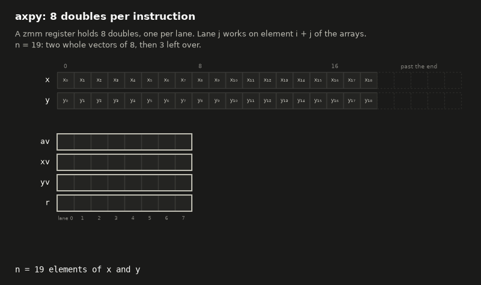
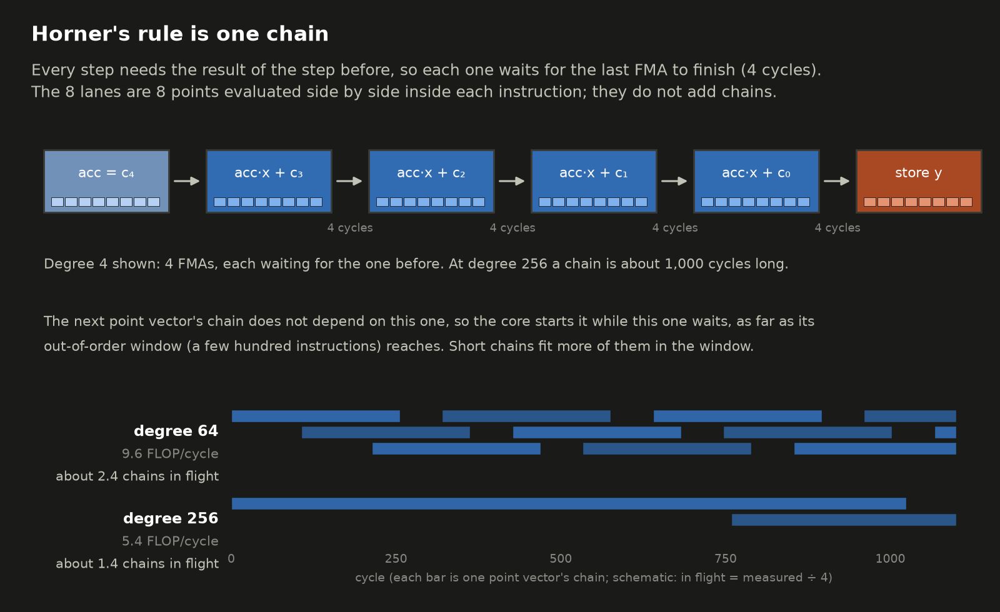
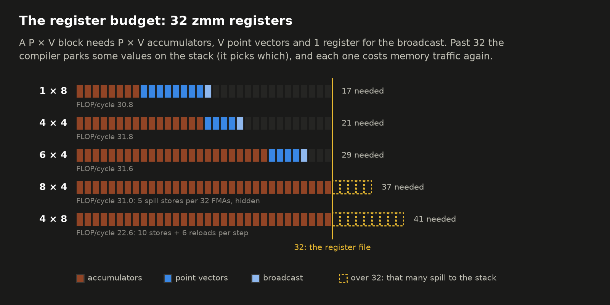
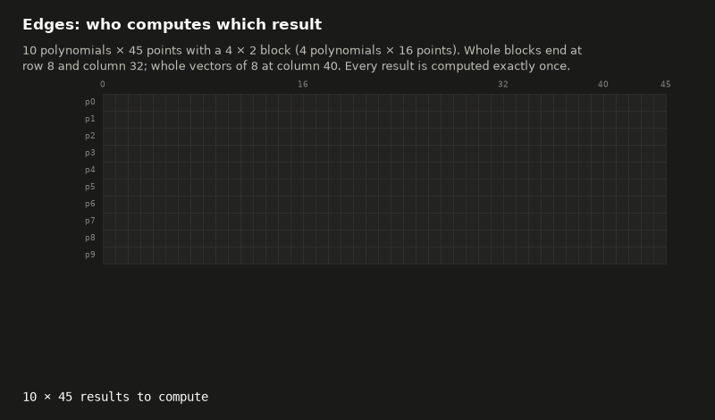

# Register blocking: a warm-up assignment

Five short exercises that teach every piece of a register-blocked micro-kernel on problems that
are not matrix multiplication. Nothing here can be pasted into `multiplyBlock`, but when you finish
you should be able to design v4's micro-kernel on paper and know how to check it.

| # | Exercise | What it teaches | Time |
|---|---|---|---|
| 1 | axpy: `y += a * x` | The intrinsics: load, store, broadcast, FMA. Tails. | 20 min |
| 2 | Sum of squares, dot product | How many independent chains you need; the limit of loads per FMA | 30 min |
| 3 | Polynomials, one at a time | Horner's rule with intrinsics; what one chain costs | 20 min |
| 4 | A block of polynomials × points | Results held in registers for a whole loop; the 32-register budget; spills | 45 to 60 min |
| 5 | Any size | Edges: a main rectangle of whole blocks plus leftovers; pointers and leading dimensions | 45 min |

## How to work

- Write your code in `exercises.cpp`. Every function there is a stub that fails its check until you
  write it.
- `make regblock EX=1` builds your file and runs exercise 1, pinned to one core. `make regblock`
  runs all five.
- Each exercise is checked against plain C++ at several sizes, including awkward ones. Only a
  version that passes is timed. Speeds are in FLOP per cycle, the same unit as the benchmarks. One
  FMA on one double is 2 FLOP, and a core's peak is 32: 2 FMA units × 8 doubles × 2.
- `solution.cpp` is my answer, and `make regblock-solution EX=1` runs it. Read it after your
  version passes, or when you are stuck.
- To see what the compiler made of your code:
  `objdump -d -C --no-show-raw-insn build/regblock | less`, then search, for example `/polyBlock`.
- Close other programs while timing. Numbers move by about 10% between runs.
- The pictures are GIFs and PNGs in `img/`. Open the Markdown preview (Ctrl+Shift+V in VS Code)
  to see them move. `python3 exercises/register_blocking/visuals.py` redraws them.

## The intrinsics

Everything is in `<immintrin.h>`, already included. The Makefile's `-march=native` turns on
AVX-512, so these compile as they are. In the names, `_mm512` means 512 bits, `_pd` means packed
doubles, and the `u` in `loadu` means the address need not be aligned.

| Intrinsic | Name, spelled out | What it does | Instruction |
|---|---|---|---|
| `__m512d` | Vector of doubles | The type: 8 doubles in one zmm register | |
| `_mm512_loadu_pd(p)` | Load unaligned, packed doubles | Loads `p[0..7]` | `vmovupd` |
| `_mm512_storeu_pd(p, v)` | Store unaligned, packed doubles | Stores `v` to `p[0..7]` | `vmovupd` |
| `_mm512_set1_pd(s)` | Set all lanes to 1 value, packed doubles | `s` in all 8 lanes | `vbroadcastsd` |
| `_mm512_setzero_pd()` | Set to zero, packed doubles | 8 zeros | `vxorpd` |
| `_mm512_fmadd_pd(a, b, c)` | Fused multiply-add, packed doubles | `a * b + c` in every lane, rounded once | `vfmadd…pd` |
| `_mm512_add_pd(a, b)` | Add, packed doubles | `a + b` in every lane | `vaddpd` |
| `_mm512_reduce_add_pd(v)` | Reduce (collapse lanes) by adding, packed doubles | The sum of `v`'s 8 lanes, as one double | several |
| `__mmask8` | Mask of 8 bits | One bit per lane: bit k on means lane k is used | |
| `_mm512_maskz_loadu_pd(m, p)` | Masked (zeroing) load unaligned, packed doubles | Loads `p[k]` into the lanes whose bit in `m` is on, 0.0 into the rest; lanes that are off read no memory | `vmovupd` with `{k}{z}` |
| `_mm512_mask_storeu_pd(p, m, v)` | Masked store unaligned, packed doubles | Stores only the lanes of `v` whose bit in `m` is on; the rest of `p[0..7]` is untouched | `vmovupd` with `{k}` |

The last three are for the bonus in exercise 1.

Look any of them up in the
[Intel Intrinsics Guide](https://www.intel.com/content/www/us/en/docs/intrinsics-guide/index.html):
search a name to see what it does and which instruction it becomes.

## Exercise 1: axpy

Write `axpy`: `y[i] += a * x[i]` for every i in `[0, n)`, for any n.

1. Broadcast `a` into a vector once, before the loop.
2. Main loop, 8 elements at a time: load 8 of x, load 8 of y, one FMA, store 8 of y.
3. Tail: the last `n % 8` elements with a plain loop.



Watch out: `n` is a `std::size_t`, which is unsigned. A condition like `i < n - 8` wraps around to
a huge number when n < 8. Write the main loop's condition so that it cannot.

**Check.** `make regblock EX=1`. Your axpy should run at about the same speed as the plain loop,
because GCC already turned the plain loop into this code. Your v1's inner loop is the same
operation, with `A(i,k)` as `a`.

**Look.** Find `axpy` and `axpyPlain` in objdump. Which instruction does your FMA become? Did GCC
keep your load of y as its own instruction, or fold it into the FMA as a memory operand?

**Bonus: a masked tail.** `axpyMasked` does the same with no scalar loop: the last 1 to 7 elements
are one masked load, FMA and store. A `__mmask8` holds one bit per lane: bit j set means lane j is
used. `_mm512_maskz_loadu_pd(m, p)` loads only the lanes that are on, filling the rest with 0.
`_mm512_mask_storeu_pd(p, m, v)` writes only those lanes. Lanes that are off are never read or
written, so they cannot fault even past the end of the array. What mask turns on the low `r`
lanes? This is one way to handle matrix columns that do not fill a whole vector.

## Exercise 2: chains and loads

Two limits decide how fast a loop of FMAs can go. This exercise measures both.

**Latency.** An FMA's result is ready 4 cycles after it starts, and the core starts up to 2 FMAs
per cycle. If every FMA needs the result of the one before it (one accumulator, one chain), the
core starts one FMA every 4 cycles: 16 FLOP per 4 cycles, an eighth of peak. With several
accumulators the chains run side by side. How many chains does it take to keep both FMA units busy
every cycle?

**Loads.** The core starts up to 2 vector loads per cycle from L1. A loop whose FMAs each need 2
loads can therefore start at most 1 FMA per cycle, whatever else you do.


Write two functions, each with `ACC` accumulators (`__m512d acc[ACC]`). n is a multiple of
`8 * ACC`.

- `sumSquares<ACC>`: the sum of `x[i] * x[i]`. Each step loads 8 doubles and does
  `acc[a] = fmadd(v, v, acc[a])`, for a = 0 to ACC - 1, then moves on by `8 * ACC`.
- `dot<ACC>`: the sum of `x[i] * y[i]`, the same with 2 loads per FMA.
- At the end, add the accumulators together with `_mm512_add_pd`, then `_mm512_reduce_add_pd`.

Tip: put `#pragma GCC unroll 16` on the line before each loop over `a`. GCC then unrolls the loop
completely, so every `acc[a]` gets its own register. An array indexed by a variable at run time
would have to live in memory.

**Predict first.** Fill this in before you run it:

| ACC | sumSquares FLOP/cycle | dot FLOP/cycle |
|---|---|---|
| 1 | | |
| 2 | | |
| 4 | | |
| 8 | | |
| 12 | | |
| 16 | | |

**Check.** `make regblock EX=2`, then compare with your predictions.

<details>
<summary>My numbers (one run of solution.cpp; yours will differ by about 10%)</summary>

| ACC | sumSquares | dot |
|---|---|---|
| 1 | 4.5 | 5.1 |
| 2 | 9.0 | 10.3 |
| 4 | 17.2 | 16.0 |
| 8 | 28.0 | 16.0 |
| 12 | 28.2 | 16.0 |
| 16 | 30.4 | 16.0 |

The plain C++ sum of squares ran at 1.0.

</details>

**Questions.**

- Why does one accumulator give about 4?
- Why does `sumSquares` need about 8 accumulators to get close to 32?
- Why does `dot` stop at 16 no matter how many accumulators it has?
- The plain C++ sum of squares runs at about 1. Why? It is the same problem v0 had.

**Take away.** A kernel near peak needs both at least 8 independent accumulators and no more than
one load per FMA.

## The polynomial bank (exercises 3 to 5)

numPolys polynomials, all of the same degree, each evaluated at the same numPoints points:

```
y[p * ldy + n] = c[0] + c[1] * x[n] + c[2] * x[n]^2 + ... + c[degree] * x[n]^degree
                 where c = coef + p * (degree + 1), the coefficients of polynomial p
```

`ldy` is the distance between rows of `y`, at least numPoints. It is there so a function can write
into part of a bigger array, which exercise 5 needs. Write nothing in a row past numPoints: the
harness checks the gap.

Evaluate each one with Horner's rule, starting from the highest coefficient:

```
acc = c[degree]
for k = degree - 1 down to 0:
    acc = acc * x + c[k]        <- one FMA: fmadd(acc, x, broadcast of c[k])
```

Why this problem: like matrix multiplication, it is a long loop of FMAs into results that stay in
place until the loop ends. But its operands are arranged differently, so the code does not carry
over to v4. The ideas do.

## Exercise 3: one polynomial and 8 points at a time

Write `polyOne`. For each polynomial, and for each vector of 8 points:

1. Load the 8 points.
2. Start the accumulator at the broadcast of the highest coefficient.
3. Run Horner's loop with `_mm512_fmadd_pd`.
4. Store the 8 results.

k counts down to 0, so use an `int`: an unsigned k would never be below 0.

**Check.** `make regblock EX=3`: PASS, and about 5 FLOP per cycle. Using exercise 2, explain why it
is not more.

**A detail that comes back in v4.** With a low degree the number goes up: at degree 64 this
function measured about 9. Each chain is then short, and the core's out-of-order window (a few
hundred instructions) holds the next point vector's chain while this one waits, so 2 or 3 chains
overlap. The harness uses degree 256 to keep the chains long. In v4 the same thing will make a
one-chain kernel look better at small tiles, whose k blocks are short, than at large ones.



## Exercise 4: a block of results in registers

Now work on a block of P polynomials × V vectors of points (8V points) at a time, with P × V
accumulators. For P = 2 and V = 4:

```
                 x[0..7]   x[8..15]  x[16..23]  x[24..31]    <- V point vectors, loaded once per block
broadcast c0 ->  acc00     acc01     acc02      acc03
broadcast c1 ->  acc10     acc11     acc12      acc13        <- P broadcasts per Horner step
```

Each Horner step does P broadcasts and P × V FMAs. Every accumulator is its own chain, so there are
P × V chains. Each broadcast coefficient is used by V FMAs, and each point vector by P.


Write `template <int P, int V> polyBlock`. For each block:

1. Load the block's V point vectors into `__m512d xv[V]`.
2. Start `__m512d acc[P][V]`: every accumulator in row p at the broadcast of polynomial p's highest
   coefficient.
3. Horner's loop over k. At each k: for each p, broadcast its coefficient k once, then update all
   V of that row's accumulators.
4. After the loop, store the P × V result vectors.

Every loop over p or v needs a constant bound and `#pragma GCC unroll 16`, so it unrolls
completely and the arrays become registers.

**The register budget.** The block needs P × V accumulators, V point vectors and 1 register for the
broadcast. The core has 32 zmm registers. The harness prints that sum for each shape it runs.

**Predict first:** for each shape the harness runs (1×1, 1×2, 1×4, 1×8, 2×4, 4×2, 4×4, 6×4, 8×4,
4×8), which ones are near 32, which are slow, and why?

**Check.** `make regblock EX=4`.

<details>
<summary>My numbers (one run of solution.cpp)</summary>

| P × V | zmm needed | FLOP/cycle |
|---|---|---|
| 1 × 1 | 3 | 5.4 |
| 1 × 2 | 5 | 9.1 |
| 1 × 4 | 9 | 16.7 |
| 1 × 8 | 17 | 30.8 |
| 2 × 4 | 13 | 28.9 |
| 4 × 2 | 11 | 31.7 |
| 4 × 4 | 21 | 31.8 |
| 6 × 4 | 29 | 31.6 |
| 8 × 4 | 37 | 31.0 |
| 4 × 8 | 41 | 22.6 |

</details>

**Look.** Find `polyBlock<4, 4>` in objdump and its Horner loop, the one that jumps back to itself
and holds the `vfmadd` instructions. In a shape that fits, the loop holds only broadcasts (or
`{1to8}` broadcasts folded into the FMAs), `vfmadd…pd` on zmm registers, and loop counting:
P × V FMAs per step (GCC may unroll the loop twice). Then look at `polyBlock<4, 8>`. Its loop has
moves to and from `(%rsp)`, the stack. Those are accumulators that no longer fit in registers:
each one makes a round trip through memory at every step again, which is what the block was
supposed to remove. `polyBlock<8, 4>` spills a few (5 stores per 32 FMAs) and still runs at about
31, because the other FMAs hide them. `polyBlock<4, 8>` spills more (10 stores and 6 reloads) and
drops to about 22.



**Questions.**

- 1 × 8 is as fast as 4 × 4 here. Why does blocking over several polynomials not help this
  problem? Count loads per FMA, and notice which operand never changes inside Horner's loop.
- Suppose the point vectors had to be loaded again at every k. Count loads per FMA for 1 × 8 and
  for 4 × 2. Which would reach 32? Answer this one before you start v4.

## Exercise 5: any size, the edges

Write `polyAny` for any numPolys and numPoints, using `polyBlock` for most of the work. Plan it on
paper first:

```
               0 ............ nMain ......... numPoints
       0      +----------------+---------------+
              |  whole P x V   |  right strip  |
              |  blocks        |               |
     pMain    +----------------+               |
              |  bottom strip  |               |
  numPolys    +----------------+---------------+
```

1. Work out pMain and nMain, where the whole blocks end.
2. `polyBlock` handles any rectangle whose sizes are multiples of its block. Point `coef`, `x` and
   `y` at the rectangle's top-left corner and keep `ldy`, the distance between rows of y. This is
   why the functions take `ldy`.
3. Cover the right strip and the bottom strip with smaller blocks, for example `polyBlock<1, 1>`
   for whole vectors of 8 points, and finish the last `numPoints % 8` points with plain scalar
   Horner, or with masks from the exercise 1 bonus.
4. Make sure the corner where the strips meet is computed exactly once.

The same plan on a small example, 10 polynomials × 45 points with a 4 × 2 block:



**Check.** `make regblock EX=5`. It tests sizes from 1 × 1 up to 50 × 1537. Expect about the same
speed as your best block at 48 × 1536, which has no edges, and a little less at 45 × 1003, where
the edges run slower code. My solution measured 31.8 and 26.5.

## From here to v4

Questions only. Answer them on paper before writing v4's code.

1. In v3's row update, `C(i, j..j+7) += A(i,k) * B(k, j..j+7)`: which operand is a broadcast,
   which a vector load and which the accumulator? Which of them change when k changes?
2. Take a block of MR rows × NV vectors of C. Per k step: how many broadcasts, vector loads and
   FMAs? How many registers? Fill in a table for a few shapes (1 × 1, 1 × 4, 2 × 2, 4 × 2, …) and
   mark each one against exercise 2's two limits and the 32-register budget.
3. Your answer to exercise 4's last question explains which of MR and NV matters more in v4.
4. The block of C starts from C's current values at every k block and goes back to C after it.
   Where do those loads and stores go, and how often do they run compared with the FMAs?
5. Exercise 5's rectangles are your tile's main region and its edges.

Then continue with "Your v4 plan" in fix 3 of the guide.
